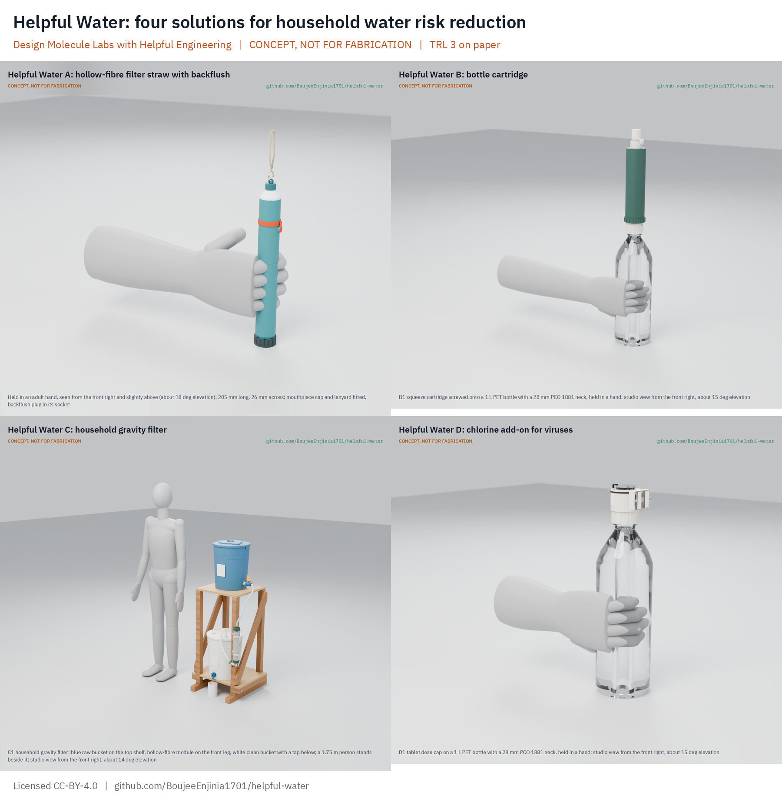

# Helpful Water

    

**Design Molecule Labs with Helpful Engineering** · **Area:** Food and water security · **TRL:** 3 of 9 (proof of concept on paper; constructable designs) · **Solutions:** A filter straw, B bottle cartridge, C household gravity filter, D chlorine add-on for viruses

Open, unpowered point-of-use water treatment, from a personal straw to a household gravity filter, with a chlorine add-on that pairs with any of them where viruses are a risk.

> **Release limitation.** Nothing here is a validated water treatment product. No prototype is used to treat water for drinking until its pathogen performance, materials safety, integrity, source suitability and claims are validated by qualified laboratories ([HWP-CLM-001](docs/12-claims.md)). All drawings, models and renders are concept media, not for fabrication.

## Concept rationale

People without safe water need something that works at the moment of drinking, with no power, no plumbing and almost no training. One product cannot serve everyone: a straw suits a person on the move but cannot serve an infant or the cooking pot, and a household filter cannot travel. Helpful Water is one program with four lettered solutions that share one evidence base, one set of user requirements, one claims register and one verification plan, so each can be judged on the same terms and paired where it helps (D's chlorine with A, B or C).

Keeping the designs open matters because the people who most need them are served by NGOs and regional makers, not by retail. Open drawings let a regional moulder make the housings and a field partner repair them, while qualified membranes and carbon are bought with data sheets and lot traceability.

## Burning platform

2.1 billion people, one in four, still lack safely managed drinking water, and 106 million drink untreated surface water ([WHO and UNICEF, 2025](https://www.who.int/news/item/26-08-2025-1-in-4-people-globally-still-lack-access-to-safe-drinking-water---who--unicef)). At least 1.7 billion people used a drinking water source contaminated with faeces in 2022, microbiologically contaminated drinking water is estimated to cause about 505,000 diarrhoeal deaths a year, and about 395,000 deaths of children under five could be avoided with safe water, sanitation and hygiene ([WHO drinking-water fact sheet](https://www.who.int/news-room/fact-sheets/detail/drinking-water)). Coverage is 38 percentage points lower in fragile contexts ([WHO and UNICEF, 2025](https://www.who.int/news/item/26-08-2025-1-in-4-people-globally-still-lack-access-to-safe-drinking-water---who--unicef)).

## Where it could be used

### By industry

| Industry | Use |
| --- | --- |
| Humanitarian response | Kits for floods, displacement and camps (A, B, D) |
| Rural water, sanitation and hygiene programs | Household treatment for drinking and cooking water (C with D) |
| Schools and clinics | Shared drinking points without a shared mouthpiece (B, C) |
| Field teams and NGOs | Portable backup when supplies fail (A, B) |
| Outdoor and travel retail | A funding channel for humanitarian units (A, B) |

### By country or region

| Country or region | Why it matters there |
| --- | --- |
| Least developed countries | People are more than twice as likely to lack basic drinking water ([WHO and UNICEF, 2025](https://www.who.int/news/item/26-08-2025-1-in-4-people-globally-still-lack-access-to-safe-drinking-water---who--unicef)) |
| Fragile and conflict-affected settings | Safely managed coverage 38 points lower than elsewhere (same source) |
| Flood-prone river basins | Turbid surface water after floods; mesh, settling and backflush matter (source classes SC2 and SC3) |

## What sparked the idea

The Helpful Engineering Infectious Disease Challenge shortlisted a copper and charcoal straw and a bottle cartridge filter. The Helpful Water team then reworked the straw into a mesh, hollow-fibre and carbon design with a backflush port, wrote the Rev A component specification and a set of concept validation questions, and asked for CAD engineering support. A review by Ali Raza asked the question that shaped this program: is a straw the right unit of intervention, when it cannot reach children under five?

## Problem

Hundreds of millions of people rely on unsafe drinking water and get preventable waterborne infections, and existing options are too expensive, too complex to run or do not reach every setting. Full problem statement: [docs/01-problem.md](docs/01-problem.md).

## Concept and solutions

| Solution | What it is | Recommended option | STEM check | BOM against target |
| --- | --- | --- | --- | --- |
| [A filter straw](solutions/A-straw) | 205 x 26 mm straw: rinseable steel mesh, bought hollow-fibre module, small carbon bed, capped backflush socket that bypasses the carbon | A1 hollow-fibre straw (164 of 215); proposed, awaiting Amish | Open: flow target and membrane grade await Amish | USD 17.46 against USD 25 |
| [B bottle cartridge](solutions/B-bottle-cartridge) | Screw-on cartridge for a 28 mm PET bottle: squeeze through mesh, carbon and a hollow-fibre module; syringe backflush | B1 squeeze (246 of 310) and B2 gravity drip (222) are within 10 %, so both go to Amish | Open: no fail; plausible rows wait on supplier data | USD 18.35 against USD 20 |
| [C household gravity filter](solutions/C-gravity) | Two buckets on a timber stand with a bought 0.1 um hollow-fibre module, settling and cloth prefilter; 45 L a day for five people in a few hours | C1 two-bucket hollow-fibre (286 of 345); proposed, awaiting Amish | Open: no fail; plausible rows wait on supplier data | USD 86.40 against USD 60 (over) |
| [D chlorine add-on](solutions/D-virus-add-on) | Tool-free NaDCC dose cap for the 28 mm neck, with keyed wells and a ball timer for the contact time; a proposed port for C's bucket | D1 tablet dose cap (174 of 215); proposed, awaiting Amish | Open: two details await Amish | USD 9.15 against USD 10 |

Every solution was taken through the kit pipeline to a constructable design on paper: STEM check with the water checks of the Helpful Engineering profile and an independent reviewer, two or three concept options each modelled to CAD detail level D3, user and product requirements with a generated traceability matrix, calculations, a priced BOM, drawings, an illustrated prototype build plan, a design decisions register, regulatory, feasibility, risk (with a design FMEA), market and plan documents.

## STEM check

Each solution's claims were checked against known physics, chemistry and biology with numbers, including membrane flux against the suction, squeeze or gravity head available, pressure drop per stage, pore size against organism size, carbon contact time, chlorine dose and contact time, integrity and silent failure, biofilm, leaching, freezing and the effort a child or elderly user can give. An independent reviewer then tried to refute every verdict, and confirmed failures were fixed under Amish's standing instruction. The program-level findings:

- The Rev A straw's 40 to 80 fibres cannot give 200 mL/min at 10 kPa; the bundle now fills the bore (about 220 fibres), but 200 mL/min at 10 kPa is still not met on paper in the 205 mm body (110 to 179 mL/min). A 245 mm body with the 0.2 um grade reaches about 213 mL/min; the flow target and membrane grade are decisions for Amish (A).
- Copper and charcoal in a straw gives seconds of contact where copper needs hours, so option A3 is dropped (A).
- Carbon downstream of a membrane in a bottle grows bacteria on the clean side, so B's carbon moved upstream (B).
- Chlorine must be dosed and left for its full contact time before any carbon, which strips it in seconds; filtered water then carries no residual and should not be stored long (A, B, D).
- An erosion feeder in a still bucket overdoses overnight, so it is dropped (D).

## Claims and limits

Helpful Water products reduce risk; they never promise safe water ([HWP-CLM-001](docs/12-claims.md)).

- A, B and C are designed to reduce bacteria and protozoa. They **do not remove viruses**. Where viral disease is a risk, also treat the water with chlorine (solution D or a WHO-recommended tablet).
- Chlorine does not inactivate *Cryptosporidium*, so D is a co-treatment with a filter, not a replacement.
- Not addressed by any solution: salt, arsenic, nitrate, fluoride, lead, PFAS, pesticides, fuel and industrial chemicals.
- Benchmarks (WHO household treatment stars, the EPA portable purifier reference, NSF P231, NSF/ANSI 42, 61 and 372) are targets, not passes, until an accredited laboratory has tested the product.

## Key components

| Solution | Components |
| --- | --- |
| A | Intake cap, 316L mesh prefilter, AS568-018 O-rings, bought hollow-fibre module with a clean header, carbon bed with fines pads, mouthpiece and cap, backflush socket and plug |
| B | Neck collar for PCO 1881, mesh, replaceable carbon capsule, bought hollow-fibre module, duckbill valve, outlet cap; B2 stand and vent tube |
| C | Raw bucket with lid, fill line and dosing port, cloth prefilter, settling volume, hose, bought hollow-fibre module with bleed screw, clean bucket with tap, timber stand, backflush syringe with check valve |
| D | Dose cap with keyed 1 L and 20 L wells, clear well plug, ball timer, foil tablet strips |

## Building the prototypes

Each solution has an illustrated prototype build plan (`solutions/*/docs/05-build-plan.md`): 3D-printed or machined housings for the prototype (injection moulding noted for scale), bought pre-potted membrane modules, sealing and assembly in order, first checks with known potable test water only, and safety stops. These are plans; nothing has been built.

## Safety

> **Safety:** Do not drink water through any prototype. Handle raw water as contaminated. Chlorine tablets and solutions are oxidisers: keep them dry, sealed and away from children, never mix them with acids, and never exceed the dose on the label. Hollow-fibre membranes can fail silently after freezing or a drop; a damaged unit is retired, not reused.

## Repository layout

| Path | Contents |
| --- | --- |
| `docs/` | Program documents: problem (HWP-PRB-001), source classes (SRC), shared user requirements (URS), regulatory (REG), market (MKT), plan (PLN), claims register (CLM), verification plan (VER), patent screen (FTO) |
| `solutions/A-straw/` | Solution A, a full kit project (docs, cad, bom, media) |
| `solutions/B-bottle-cartridge/` | Solution B |
| `solutions/C-gravity/` | Solution C |
| `solutions/D-virus-add-on/` | Solution D |
| `.kit/` | Design Molecule kit 1.9.1-he (STANDARDS section 25 is the joint profile); each solution carries its own copy |
| `LICENSE-*.txt`, `LICENSES/`, `REUSE.toml` | Licences per the Helpful Engineering licensing guide |

## Documentation

Controlled documents follow the portfolio [documentation standard](.kit/STANDARDS.md), including the joint Design Molecule and Helpful Engineering profile (section 25). Program: `python .kit/render.py --check` from the repo root. Each solution: `cd solutions/<folder> && python .kit/render.py --check`.

| Document | ID |
| --- | --- |
| [Program problem statement](docs/01-problem.md) | HWP-PRB-001 |
| [Source and use-environment classes](docs/01c-sources.md) | HWP-SRC-001 |
| [Shared user requirements](docs/03a-user-requirements.md) | HWP-URS-001 |
| [Regulatory and standards register](docs/07-regulatory.md) | HWP-REG-001 |
| [Market and viability](docs/10-market.md) | HWP-MKT-001 |
| [Program plan](docs/11-plan.md) | HWP-PLN-001 |
| [Claims register](docs/12-claims.md) | HWP-CLM-001 |
| [Verification plan](docs/13-verification-plan.md) | HWP-VER-001 |
| [Patent and freedom-to-operate screen](docs/14-ip-screen.md) | HWP-FTO-001 |

## Helpful Engineering

Helpful Water is a joint program of Design Molecule Labs and [Helpful Engineering](https://helpfulengineering.org), a global open engineering nonprofit. It follows the [Helpful Engineering licensing guide](https://helpfulengineering.org/licensing-guide/) and the Helpful Engineering project process: purpose, kill criteria, targets and KPIs, the minimum viable team, the 60 to 90 day plan and the support needed from Helpful Engineering are in [HWP-PLN-001](docs/11-plan.md). Contributors confirm the guide's warranty in [CONTRIBUTING.md](CONTRIBUTING.md).

## Credits

Amish Chadha, Ali Raza, Suraksha Bhat, Lillian Fernandes, Raksha Thammaiah and James Butler (Design Molecule Labs with Helpful Engineering). See [CONTRIBUTORS.md](CONTRIBUTORS.md) and [CITATION.cff](CITATION.cff).

## Licenses

Following the [Helpful Engineering licensing guide](https://helpfulengineering.org/licensing-guide/):

- Hardware, CAD, drawings, BOM, build plans, firmware and test software: CERN-OHL-P-2.0 ([LICENSE-HARDWARE.txt](LICENSE-HARDWARE.txt))
- Software not needed for the hardware to work: Apache-2.0 ([LICENSE-SOFTWARE.txt](LICENSE-SOFTWARE.txt))
- Documentation, guides and pictures: CC-BY-4.0 ([LICENSE-DOCUMENTATION.txt](LICENSE-DOCUMENTATION.txt))

The file-by-file split is in [REUSE.toml](REUSE.toml). No archive DOI is minted for this repository.
