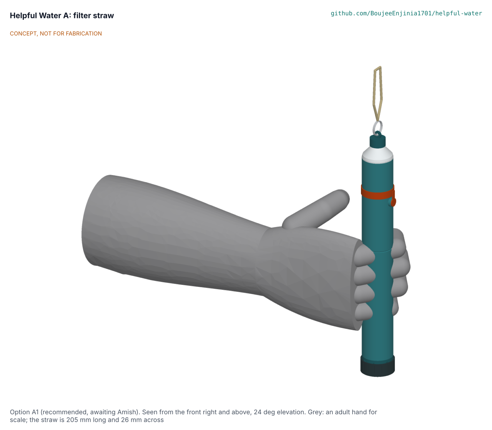
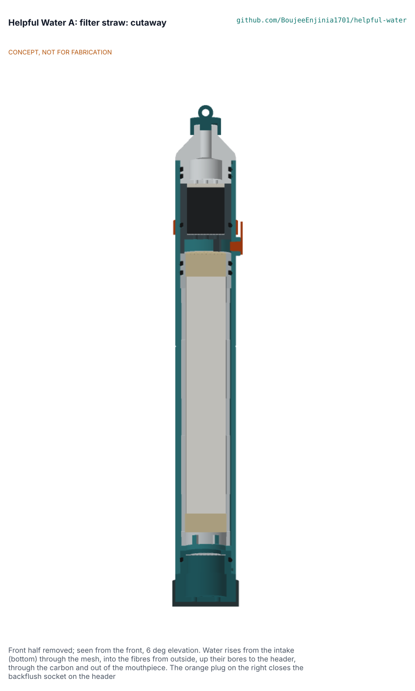
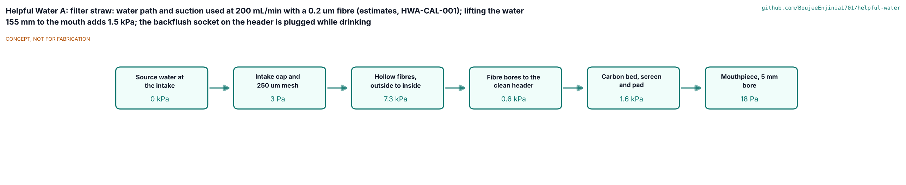
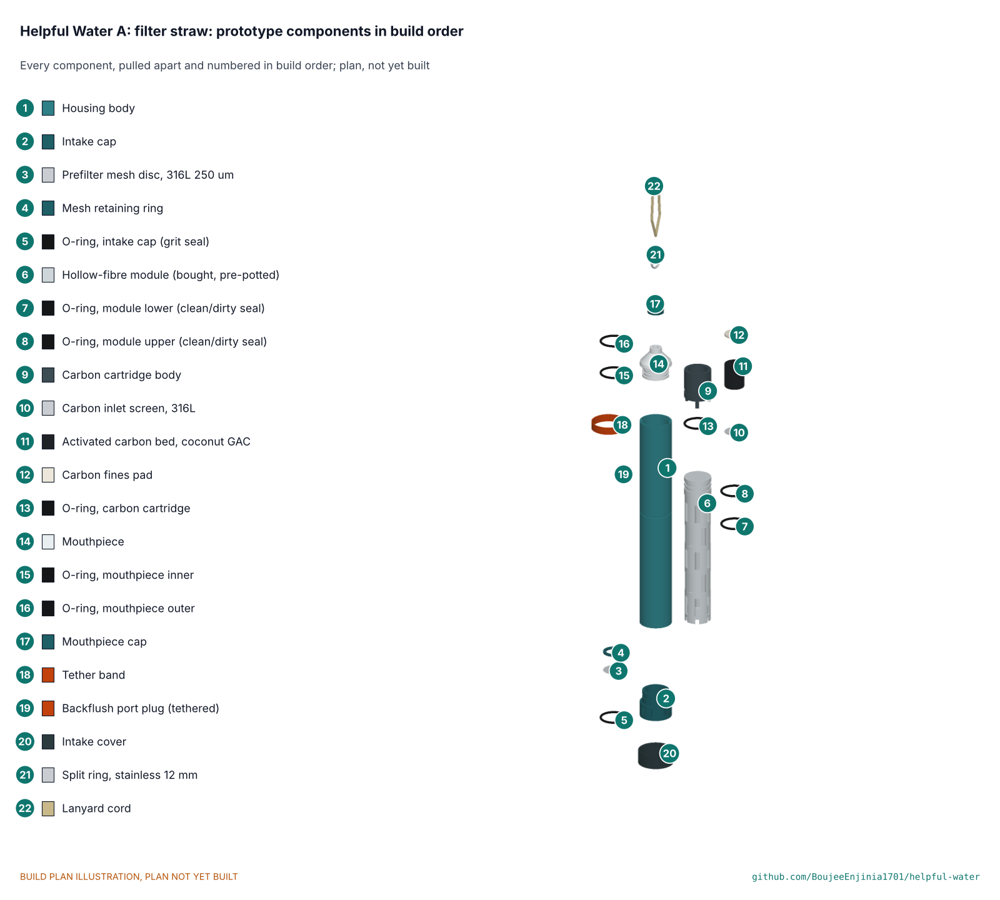

# Helpful Water A: filter straw



   

**Area:** Food and water security · **TRL:** 3 of 9 (proof of concept on paper; stage P3) · **Value-engineering target:** USD 25 prototype parts (estimate USD 17.46) · **Difficulty:** 3 of 5 · **Program:** [Helpful Water](../../README.md), solution A

An open, unpowered personal filter straw: a rinseable steel mesh, a bought hollow-fibre membrane and a small carbon bed in a body 205 mm long and 26 mm across, with a capped backflush socket that cleans the fibres without passing the carbon. Designed to reduce bacteria and protozoa in clear freshwater. **It does not remove viruses.** The concept choice (option A1) is proposed and awaiting Amish.

[Hero (concept render)](media/hero.png) · [Cutaway](media/cutaway.png) · [Exploded view](media/exploded.png) · [Water path](media/flow.png) · [Interactive 3D model](media/viewer.html) · [Concept blueprint (PDF)](media/concept-blueprint.pdf) · [General arrangement HWA-DWG-001 (PDF)](cad/drawings/HWA-DWG-001.pdf) · [Half section HWA-DWG-002 (PDF)](cad/drawings/HWA-DWG-002.pdf) · [Sizing note HWA-CAL-001](docs/04-calcs/01-sizing.md) · [STEM check](docs/01b-stem-check.md) · [Prototype build plan](docs/05-build-plan.md) · [Decisions](docs/06-design-decisions.md) · [Review](docs/REVIEW.md)

The photoreal product render (`media/render-hero.png`) and the options picture need Blender and are waiting to be rendered on Amish's Mac; the hero above is the concept render.

## Concept rationale

A straw is the smallest thing that puts a pathogen barrier between a person and the water in front of them, with no power and nothing to set up. Commercial hollow-fibre straws prove the principle; what they leave out is what matters in a crisis: a prefilter for muddy water that rinses in the field, a way to clean the membrane that cannot push dirt or carbon fines into the clean side, a way to tell that a fibre has cracked, and a design open enough to be moulded regionally. This straw keeps the Helpful Engineering Rev A layout (mesh, outside-in hollow fibres, carbon, backflush) and makes it constructable and honest about its limits.

Design thesis: **simple and checkable**: one barrier, every seal doubled, every service step on the dirty side or through one capped socket.

## Burning platform

- 2.1 billion people still lack safely managed drinking water and 106 million drink untreated surface water ([WHO and UNICEF, 2025](https://www.who.int/news/item/26-08-2025-1-in-4-people-globally-still-lack-access-to-safe-drinking-water---who--unicef), checked 2026-11-11).
- At least 1.7 billion people used a source contaminated with faeces in 2022, and contaminated drinking water causes about 505,000 diarrhoeal deaths a year ([WHO fact sheet](https://www.who.int/news-room/fact-sheets/detail/drinking-water), checked 2026-11-11).
- In a large household-filter deployment in Kenya, 24 % of households were not using their filters at 12 months and only 56 % used them correctly ([Stanford Social Innovation Review](https://ssir.org/articles/entry/thirty_million_dollars_a_little_bit_of_carbon_and_a_lot_of_hot_air)): a design that is not easy to use and to check is not used.

## Where it could be used

### By industry

| Industry | Use |
| --- | --- |
| Humanitarian response | Emergency kits for displacement and flood response, with chlorine co-treatment where viruses are a risk |
| Field work | NGO, survey and health staff drinking from streams and stored water |
| Outdoor retail | Travellers and hikers; a funding channel for humanitarian units (HWP-MKT-001) |
| Regional manufacturing | Polypropylene moulding of the open housing; assembly round a bought module |

### By country or region

| Country or region | Why it matters there |
| --- | --- |
| Fragile contexts | Safely managed drinking water coverage is 38 percentage points lower than elsewhere ([WHO and UNICEF, 2025](https://www.who.int/news/item/26-08-2025-1-in-4-people-globally-still-lack-access-to-safe-drinking-water---who--unicef)) |
| Typhoon and flood regions (for example the Philippines and Malaysia, where straws have been deployed) | Short-term personal protection while supplies are restored (concept validation questions); not for flood runoff as a sole barrier |
| Least developed countries | People are more than twice as likely to lack basic drinking water (WHO and UNICEF, 2025) |
| Arsenic and fluoride regions (for example Bangladesh, West Bengal, parts of the Rift Valley) | **Not** a solution there: the straw does not remove dissolved chemicals; screen the source first (HWP-SRC-001) |

## What sparked the idea

Helpful Engineering's Infectious Disease Challenge proposed a pocket straw for at-risk communities in its viability shortlist, first as a copper and charcoal straw, then, in the Helpful Water update of February 2026 and the Rev A component specification of October 2026, as a mesh, hollow-fibre and carbon straw with a backflush port. This folder takes that specification to a constructable design with Design Molecule Labs.

## Problem

People drinking from streams, lakes, stored or distrusted water need a personal barrier against bacteria and protozoa that works at a child's suction, can be cleaned in the field and never fails silently, at a humanitarian cost per litre ([HWA-PRB-001](docs/01-problem.md), citing HWP-PRB-001). Design with, not for: targets stay proposals until persona trials with a field partner.

## Concept



Water enters the intake cap, passes a 250 um 316L mesh, flows round about 220 hollow fibres (0.8 mm outside, 102 mm active) and through their walls from outside to inside; the fibre bores open into a clean header sealed by two O-rings, and from there the water passes 2 g of coconut-shell carbon and a 5 mm mouthpiece bore. To clean it, the user caps the mouthpiece (its plug dead-ends the carbon), pulls the tethered plug from the socket on the header and pushes 20 mL of clean water back through the fibres and out of the intake. The same socket gives a proposed air-hold check: a broken fibre shows as bubbles. Quarter-turn bayonets keep the body at 26 mm. See [HWA-PRC-001](docs/02-concept.md).



## Concept options

Three concepts with different working principles were modelled at detail level D3 and scored ([HWA-OPT-001](docs/02a-concept-options.md)): **A1 hollow-fibre straw with backflush (164 of 215)**, A2 ceramic tube straw that the user scrubs (135; fails on flow, about 10 mL/min) and A3 copper and charcoal straw (125; fails on efficacy: seconds of copper contact where hours are needed). A1 is recommended; the choice is awaiting Amish. A1 is the reverse of the arrangement claimed in US 8,852,439 B2 on a desk reading; an attorney confirms. The options picture is rendered in Blender and is pending (scenes exported).

## STEM check

[HWA-STM-001](docs/01b-stem-check.md): option A1 holds within known science once eleven details are fixed under Amish's standing instruction, among them O-rings that fit the bore (AS568-018, reamed glands), a bundle that fills the bore (Rev A's 40 to 80 fibres gave 19 to 78 mL/min at 10 kPa), a high-flux microfiltration membrane with an absolute rating, a backflush route that never passes the carbon, a carbon mass of 2 g, a hydrophilic fines pad and an air check that finds gross defects. It does not reach the Rev A flow target on paper: **110 to 179 mL/min at 10 kPa** with a 0.1 or 0.2 um fibre (clean water, 20 C, shell primed), against 200; **45 to 74 mL/min for a child at 5 kPa** (20 to 33 minutes for 1.5 L); a third less in cold water and less again on turbid water or with air in the shell. The 400 mL/min that straw users like needs 21 to 33 kPa. The membrane grade and the flow target go to Amish (D2, D3). An independent reviewer agent, run as a separate process without the design reasoning, attacked every verdict on 2026-11-11: of 27 rows 13 held, 10 were weak and 4 refuted, and it found 13 missed claims; the findings, the fixes and three new decisions for Amish (D10 to D12) are recorded in the STEM check.

## Key components

Intake cap with captive 316L mesh and bayonet; polypropylene housing 26 x 22 x 178 mm with seat ring, dip line and backflush socket; bought pre-potted outside-in hollow-fibre module with a header collar; six AS568-018 EPDM O-rings; carbon cartridge (16 x 20 mm bed of 12 x 40 coconut GAC, 150 um screen, fines pad); bayonet mouthpiece with a 10 mm tip; mouthpiece cap with bore plug; tethered silicone socket plug; intake cover; lanyard; 20 mL syringe. Prototype parts USD 17.46 ([bom/bom.csv](bom/bom.csv)); 66 g.

## Building the prototype

The [prototype build plan](docs/05-build-plan.md) (HWA-BLD-001) shows how to print the six polypropylene parts and cast the two silicone parts, how to fit the bought module, O-rings and carbon without glue or potting, and how to assemble the straw in eight steps, each with a picture. First checks use known potable test water and a hand vacuum pump only. It is a plan, not yet built.



## Safety

Nobody drinks from a prototype: build checks use known potable test water only, and no straw treats water for drinking until laboratories have validated it (release limitation below). The straw does not remove viruses or dissolved chemicals. A fibre cracked by freezing or a drop can pass pathogens with no change in flow: do not freeze it wet, and replace it after a hard drop or a suspected freeze; the air check finds gross defects only. Backflush only with water already treated (never from the source), gently, with the mouthpiece cap on, never by mouth; do not dip past the dip line, and keep the socket plug in; do not share a mouthpiece. Discard the first 3 x 40 mL through a new straw. With a chlorine co-treatment, finish its contact time in the container before drinking.

## Claims and limits

From the program claims register [HWP-CLM-001](../../docs/12-claims.md):

- **May say now (design intent):** designed to reduce bacteria and protozoa in clear freshwater; the carbon stage is intended to improve chlorine taste.
- **Only after accredited, independent testing:** a measured log reduction for named bacteria and cyst surrogates at a stated flow, turbidity and life; a chlorine taste reduction under NSF/ANSI 42.
- **Never:** that it purifies, sterilises, is virus-proof, makes any water safe or removes all contaminants.
- **Exclusions on the product:** viruses, thin bacteria such as *Leptospira* (unless tested; HWA-STM-001 S11), salt, arsenic, nitrate, fluoride, lead, PFAS, pesticides, cyanotoxins, fuel and industrial chemicals, radiological contaminants; do not freeze when wet.
- **On-product virus warning:** "Reduces bacteria and protozoa. Does not remove viruses. Where viral disease is a risk, also treat the water with chlorine (solution D or a WHO-recommended tablet)." Shown in words and as a pictogram (virus crossed out, tablet beside it). Amish's decision of 2026-11-11: no virus claim, co-treat.
- **Release limitation:** no prototype is used to treat water for drinking until its pathogen performance, materials safety, integrity, source suitability and claims are validated by qualified laboratories.

## Helpful Engineering

This is solution A of Helpful Water, a joint program of Design Molecule Labs and Helpful Engineering that develops four open, unpowered point-of-use solutions (A straw, B bottle cartridge, C household gravity filter, D chlorine add-on for viruses) from one evidence base. Shared documents (problem, source classes, user requirements, claims, regulatory, market, plan, verification plan, patent screen) are in the [program README](../../README.md) and `../../docs/`; this folder cites them by doc_id and adds what is specific to the straw.

## Repository layout

```
docs/                       controlled documents (PRB, STM, OPT, PRC, URS, PRS, RTM, CAL, BLD, DEC, REG, FEA, RSK, MKT, PLN) and REVIEW.md
docs/04-calcs/              sizing.py (HWA-CAL-001), stem_check.py, results
docs/decisions/             decision records (concept selection, design for construction, STEM fixes)
docs/05-build-plan/         build plan pictures
cad/src/model.py            parametric model, options A1 to A3 at detail level D3 (kit 1.9)
cad/src/straw_parts.py      helpers: revolved profiles, O-rings, bayonets, mesh, fibre bundle, potting
cad/src/sheets.py           drawings HWA-DWG-001 and 002, STL export
cad/src/build_plan_media.py build plan pictures and making sketches HWA-DWG-101 to 108
cad/src/concept_media.py    hero, cutaway, exploded, flow, 3D viewer, concept blueprint
cad/src/product_model.py    appearance model and render views (for Blender)
cad/step/, cad/stl/, cad/drawings/   exports
bom/bom.csv                 priced bill of materials
.kit/                       shared documentation kit 1.9.1-he (do not edit here)
```

## Documentation

Controlled documents follow the portfolio standards in [.kit/STANDARDS.md](.kit/STANDARDS.md), including the Helpful Engineering profile (section 25). From this folder: `python .kit/render.py --check` validates them, `python .kit/cad_check.py --export` runs the CAD fidelity check, `python docs/04-calcs/sizing.py` and `python docs/04-calcs/stem_check.py` rerun the calculations, and `python .kit/trace.py` regenerates the traceability matrix.

## Credits

Amish Chadha, Ali Raza, Suraksha Bhat, Lillian Fernandes, Raksha Thammaiah and James Butler (Design Molecule Labs with Helpful Engineering). AI assistance (Claude) was used for research, calculations, CAD and documentation; design direction and all decisions are Amish Chadha's, recorded in [docs/06-design-decisions.md](docs/06-design-decisions.md).

## Licenses

Following the [Helpful Engineering licensing guide](https://helpfulengineering.org/licensing-guide/):

- Hardware (CAD sources, STEP, drawings, BOM, build plan pictures): CERN-OHL-P-2.0, [LICENSE-HARDWARE.txt](../../LICENSE-HARDWARE.txt)
- Software (calculation scripts, kit tools, web viewer): Apache-2.0, [LICENSE-SOFTWARE.txt](../../LICENSE-SOFTWARE.txt)
- Documentation (controlled documents, README, renders and concept pictures): CC-BY-4.0, [LICENSE-DOCUMENTATION.txt](../../LICENSE-DOCUMENTATION.txt)

---

Design Molecule Labs with Helpful Engineering
