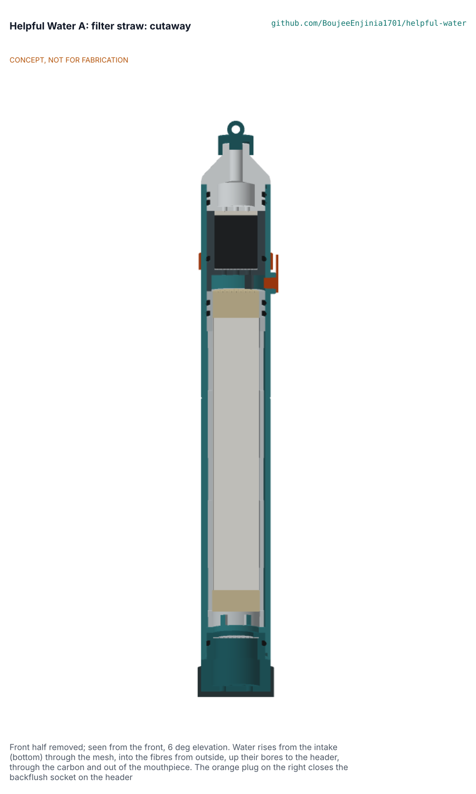

# Helpful Water A: filter straw design precis

Option A1 is a personal filter straw, 205 mm long and 26 mm across, that is designed to reduce bacteria and protozoa in clear freshwater: a rinseable 316L mesh, a bought pre-potted hollow-fibre module run outside-in, a clean header with a capped backflush socket that bypasses the carbon, a 2 g carbon bed for chlorine taste and a bayonet mouthpiece. It does not remove viruses. Its weak point is flow: about 120 to 200 mL/min at a 10 kPa sip, depending on the membrane grade Amish chooses (HWA-DEC-001 D2), and 50 to 80 mL/min for a child. The concept choice is **decided by Amish on 2026-11-11** (HWA-DEC-001 D1).

> **Release limitation.** No prototype is used to treat water for drinking until its pathogen performance, materials safety, integrity, source suitability and claims are validated by qualified laboratories (HWP-CLM-001). Prototypes are tested with known potable test water only.

## How it works

1. The user takes off the intake cover and the mouthpiece cap, dips the intake end no deeper than the dip line (110 mm) and sips.
2. Water enters eight side slots and six end holes of the intake cap and passes the 250 um 316L mesh, which stops grit and debris.
3. In the dirty bay it flows round about 220 hollow fibres (0.8 mm outside, 0.5 mm bore, 102 mm active) and passes through their walls from outside to inside. The membrane is the barrier for bacteria and protozoan cysts.
4. The fibre bores are closed at the bottom potting and open at the top potting into a 6 mm clean header. Two AS568-018 O-rings on the module collar seal the clean header from the dirty bay.
5. From the header the water passes a 150 um screen, 2 g of coconut-shell GAC (contact about 1.2 s at 200 mL/min, intended to reduce chlorine taste), a fines pad and the mouthpiece's outlet grid, and leaves through a 5 mm bore in a 10 mm tip.

**Backflush.** With the mouthpiece cap on (its plug closes the bore, so the carbon is dead-ended), the user pulls the tethered plug out of the socket on the header, fills the supplied 20 mL syringe with water already treated (boiled, tablet-treated or bottled; never from the source), pushes it in gently at about 50 kPa and lets it run out of the intake; three strokes take about a minute. Backflush water never passes the carbon (HWA-DEC-001 F4).

**Air check (HWA-DEC-001 D4).** With the straw wet and the cap on, the user pushes a syringe of air into the socket to the 6 mL mark and holds it for 10 s; if the plunger keeps moving, a fibre or collar seal is broken and the straw is retired. The check finds gross defects only (5.6 um and larger), not bacterial-size flaws. Afterwards the straw is re-primed under water.

**Priming and first use.** A new straw primes itself on the first sips while the fibres are dry; the first 3 x 40 mL are spat out (first flush). Between uses the intake cover stays on so the dirty shell stays full of water; air trapped in it cuts the flow (HWA-CAL-001 section 4.2). With a chlorine co-treatment, the contact time is completed in the container before drinking through the straw.

## Main components

| # | Component | Made or bought | Material |
| --- | --- | --- | --- |
| 1 | Intake cap with bayonet lugs and grit O-ring | Made (printed; moulded at scale) | Polypropylene |
| 2, 3 | Mesh disc 17 mm, 250 um, and retaining ring | Bought, made | 316L; polypropylene |
| 4 | Housing body 26 x 22 x 178 mm, seat ring, bayonet grooves, socket boss, dip line | Made | Polypropylene |
| 5 | Pre-potted outside-in hollow-fibre module with header collar | Bought | Hydrophilic PES or PVDF fibres, PU or epoxy potting, PP collar and cage |
| 6 | O-rings AS568-018, six | Bought | EPDM, drinking-water listed |
| 7 to 10 | Carbon cartridge: cup with legs, 150 um screen, 2 g GAC, fines pad | Made and bought | PP, 316L, coconut GAC, PP non-woven |
| 11, 12 | Mouthpiece with bayonet and two O-rings; snap cap with bore plug | Made | Polypropylene |
| 13, 14 | Tethered socket plug and band; intake cover | Made (cast) | Silicone |
| 15, 16, 17 | Split ring, lanyard, 20 mL syringe | Bought | Stainless, polyester, PP |

## Key design choices (decided by Amish on 2026-11-11)

- Outside-in flow into single-ended fibres whose bores open into the clean header: the reverse of claim 1 of US 8,852,439 B2 (HWA-OPT-001; attorney to confirm, C4).
- Bundle fills the bore and the central permeate tube is dropped (F2, made under the standing instruction).
- High-flux microfiltration membrane, at least 1,800 L/(m2 h bar) (F3, made); 0.1 or 0.2 um grade (D2, open).
- Internal quarter-turn bayonets keep the body at 26 mm; the plug and band make it 29.6 mm across (HWA-DDR-002).
- Backflush socket on the header with the carbon dead-ended by the cap plug (F4, made).
- Carbon optional by variant (D7) and possibly combined with the mouthpiece as one replaceable top (D6).

## First-order numbers (HWA-CAL-001)

| Quantity | Value | Assumption |
| --- | --- | --- |
| Flow at 10 kPa, clean water, 20 C | 110 (0.1 um) to 179 (0.2 um) mL/min, shell primed (upper bound: turbid water fouls) | A1, A3, A13 |
| Flow for a child at 5 kPa | 45 to 74 mL/min (20 to 33 min for 1.5 L) | A2 |
| Suction for 400 mL/min | 21 to 33 kPa | A1 |
| Carbon | 1.9 to 2.0 g, 1.2 s contact at 200 mL/min | A5 |
| Mass, size | 66 g dry (106 g full); 205 x 26 mm (29.6 mm across the plug) | Model |
| Prototype parts | USD 17.46 (target USD 25) | BOM |
| Cost per litre | USD 0.011 prototype, about 0.002 at scale | A11, A12 |

## Safety

> **Safety:** This is a paper design. Nobody drinks from a prototype: build checks use known potable test water only, until an accredited laboratory has validated pathogen reduction, materials and integrity (release limitation above).

> **Safety:** The straw does not remove viruses, salt, arsenic, nitrate, fluoride, lead, PFAS, pesticides, cyanotoxins, fuel or industrial chemicals, or radiological contaminants. Where viral disease is a risk the water must also be treated with chlorine (solution D or a WHO-recommended tablet), and the product says so in words and as a pictogram (HWP-CLM-001).

> **Safety:** A fibre cracked by freezing or a drop lets water through normally while pathogens pass. Do not freeze the straw when wet; retire it, or run the air check (gross defects only), after a hard drop or a suspected freeze.

> **Safety:** Backflush only with clean water, with the mouthpiece cap on and never by mouth. Do not dip past the dip line: the header socket and the mouthpiece joint must stay out of the source water. Do not share a mouthpiece between people.

> **Safety:** Use only on the source classes HWP-SRC-001 marks suitable for solution A (SC1, SC2, SC5; SC3 after settling, SC4 after certified analysis). Not for flood or urban runoff, brackish, sea, industrial or mining water.

## Open questions

The decisions, all made by Amish on 2026-11-11, are in HWA-DEC-001: concept (D1), membrane grade (D2), flow target and length (D3), the air-hold check (D4), the syringe (D5), a combined carbon and mouthpiece top (D6), carbon at all (D7), mesh aperture (D8), a mouthpiece valve (D9).

Licence: this document is licensed under CC-BY-4.0 (Creative Commons Attribution 4.0 International), following the Helpful Engineering licensing guide. Design Molecule Labs with Helpful Engineering.
