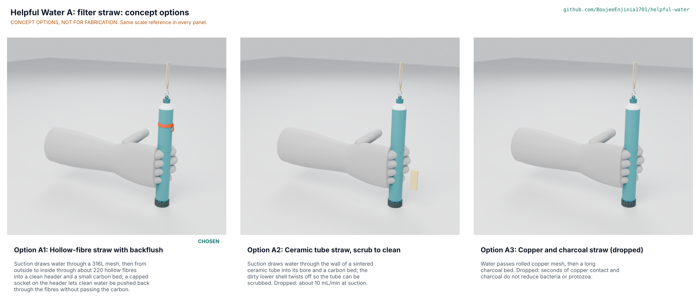

# Helpful Water A: filter straw concept options

Recommendation: option A1, the hollow-fibre straw with an isolated backflush socket, scores 164 of 215 against 135 for the ceramic tube straw (A2) and 125 for the copper and charcoal straw (A3), more than 10 % ahead; A2 and A3 also fail the STEM check on their working principle and are dropped. The choice is **decided by Amish on 2026-11-11** (HWA-DEC-001 D1, HWA-DDR-001). Method: STANDARDS section 21.

The options picture is rendered in Blender Cycles from the D3 models in `cad/src/model.py`. The scenes are exported with `python .kit/options.py --export`, rendered on Amish's Mac and composed into `media/options.png` with `python .kit/options.py --compose=<dir>`.

## The options

### Option A1: hollow-fibre straw with backflush (Rev A, made constructable)

Working principle: suction draws water through a 316L mesh and then from outside to inside through about 220 hydrophilic hollow fibres into their bores, which open into a clean header; from the header it passes a 2 g carbon bed to the mouthpiece. A capped socket on the header takes a 20 mL syringe of clean water that flows back through the fibre walls and out of the intake without passing the carbon, because the mouthpiece cap plugs the carbon outlet. The same socket gives a 50 kPa plunger-hold air check that shows a broken fibre or failed collar seal (gross defects only). First-order numbers: 205 x 26 mm, 66 g, 26 parts, USD 17.46 of prototype parts, 110 to 179 mL/min at 10 kPa (0.1 or 0.2 um fibre), 45 to 74 mL/min for a child at 5 kPa. Key risks: flow below what users like, silent fibre damage, carbon hygiene. Needs from a partner: a module maker with a pre-potted outside-in module and permeability data; an accredited laboratory.

### Option A2: ceramic tube straw, scrub to clean

Working principle: suction draws water through the wall of a sintered ceramic microfiltration tube (17 mm across, 4 mm wall, closed at the bottom) into its bore and then a carbon bed. The tube hangs from a sealed head; the dirty lower shell twists off so the user can scrub the tube without ever opening the clean side. First-order numbers: 101 g, 25 parts, about 10 mL/min at 10 kPa. STEM check: **Fails** (X1): ceramic is hundreds of times less permeable than a fibre bundle of the same size and has a fraction of its area. Dropped.

### Option A3: copper and charcoal straw (viability shortlist)

Working principle: water passes rolled copper mesh and then a long charcoal bed. First-order numbers: 98 g, 20 parts, cheapest to make. STEM check: **Fails** (X3 to X5): a sip gives about 5 s of copper contact where copper pots need about 16 h; charcoal is an adsorbent, not a size barrier; neither touches *Cryptosporidium*. Copper leaching against the 1.3 mg/L action level is probably not the problem in a sip (X6), but there is nothing for it to buy. Dropped, matching the Rev A decision to remove copper.

## First-order numbers

Table 1. Options compared (HWA-CAL-001, model masses).

| Quantity | Option A1 | Option A2 | Option A3 |
| --- | --- | --- | --- |
| Estimated parts cost (USD, prototype) | 17.46 (BOM) | About 20 (ceramic element to quote) | About 10 |
| Mass (g) | 66 | 101 | 98 |
| Flow at 10 kPa (mL/min, clean, 20 C) | 110 to 179 | About 10 | Above 200 (no barrier) |
| Pathogen barrier | Size exclusion, 0.1 to 0.2 um fibre | Size exclusion, ceramic | None that works in a sip |
| Cleaning | Syringe backflush through the header socket | Scrub the tube | Rinse |
| Parts count (model) | 26 | 25 | 20 |
| STEM check | No Fails; S2, S3, S5 closed by HWA-DEC-001 D2, D3 | Fails (X1, flow) | Fails (X3 to X5, efficacy) |

## Patent check against US 8,852,439 B2 (HWP-FTO-001)

Claim 1 of US 8,852,439 B2 covers a drinking-straw filtration method with one bundle of hollow fibres held in a support member that forms a compartment before the outlet, water entering the fibres' open ends, passing outward through the membrane walls into that compartment and leaving through the mouthpiece under the drinker's suction, with the fibres' closed ends or looped parts extending into the outlet compartment ([Google Patents](https://patents.google.com/patent/US8852439B2/en), checked 2026-11-11). Option A1 runs the other way: water reaches the fibres from outside, passes inward through the walls into the bores, and the bores' open ends discharge into the clean header at the outlet end, while the closed ends sit in the bottom potting at the inlet end. The closed ends face the inlet, not the outlet, and the lumens carry clean water, not feed. On this desk reading A1 is the reverse of the claimed arrangement. A2 and A3 use no hollow fibres. This is not legal advice; a patent attorney gives the opinion before any product is made for distribution (HWA-DEC-001 C4).

## Scoring

Table 2. Weighted scoring (weights: High UR 3, Medium 2, Low 1; scores 1 to 5). Maximum 215.

| Criterion | Source | Weight | A1 | A2 | A3 | Reason |
| --- | --- | --- | --- | --- | --- | --- |
| Reduce bacteria | UR-001 | 3 | 5 | 4 | 1 | Fibre and ceramic exclude by size; copper and charcoal do not in a sip |
| Reduce protozoa | UR-002 | 3 | 5 | 4 | 1 | Same; nothing in A3 acts on cysts |
| Usable flow | UR-004 | 3 | 3 | 1 | 4 | A1 tight (110 to 179 mL/min at 10 kPa); A2 about 10; A3 free-flowing |
| Low daily upkeep | UR-007 | 3 | 3 | 2 | 5 | A1 needs a syringe backflush; A2 needs the shell off and a scrub |
| Know when it fails | UR-008 | 3 | 4 | 3 | 1 | A1 air-hold check and falling flow; A3 flows the same whether it works or not |
| No bypass in service | UR-009 | 3 | 4 | 4 | 3 | A1 backflush avoids carbon, but a carbon change opens the clean side; A2 never opens it |
| Hygienic storage | UR-010 | 3 | 3 | 3 | 2 | Carbon after the barrier in A1 and A2; long wet charcoal bed in A3 |
| Safe materials | UR-011 | 3 | 4 | 4 | 2 | Listed grades exist; copper release in A3 to measure |
| Portable | UR-012 | 2 | 5 | 4 | 4 | 66 g against about 100 g |
| Affordable | UR-014 | 3 | 4 | 3 | 5 | Module is A1's main cost; ceramic element harder to source |
| Resupply | UR-015 | 2 | 3 | 3 | 3 | Each carries a carbon consumable |
| Drops and freezing | UR-017 | 2 | 2 | 2 | 4 | Fibres and ceramic both crack silently |
| Taste | UR-018 | 2 | 4 | 4 | 3 | Copper can taste metallic |
| Cleanable prefilter | UR-019 | 2 | 4 | 4 | 4 | Same captive mesh in the intake cap |
| Buildable with local skills and tools | | 2 | 4 | 3 | 5 | Printed parts plus bought module; ceramic tube needs a supplier |
| Safety | | 3 | 4 | 3 | 1 | A3 gives false reassurance |
| Maintenance | | 1 | 3 | 2 | 4 | Syringe and carbon change against scrubbing |
| **Weighted total** | | | **164** | **135** | **125** | |

## Recommendation

Option A1 is recommended: it is the only option whose working principle holds at suction, and it leads A2 by 21 %. The runner-up's best idea is A2's service rule: clean the barrier without opening the clean side. A1 already does this for backflushing and for rinsing the mesh (the mesh is captive in the dirty-side intake cap); the remaining clean-side opening is the carbon change, and the proposal to make the carbon cartridge and mouthpiece one replaceable top is recorded as HWA-DEC-001 D6. Recorded as **decided by Amish on 2026-11-11** in HWA-DEC-001 D1 and argued in HWA-DDR-001.

Licence: this document is licensed under CC-BY-4.0 (Creative Commons Attribution 4.0 International), following the Helpful Engineering licensing guide. Design Molecule Labs with Helpful Engineering.
