# Helpful Water A: filter straw prototype build plan

**Plan, not yet built.** How to build the first proof-of-concept straw, component by component. Building and testing to it is TRL 4 work. Decisions still to be made are kept in the design decisions register (HWA-DEC-001), not here.

> **Safety:** Nobody drinks from this prototype. Every check in this plan uses known potable test water only (release limitation, HWP-CLM-001). Printed plastic is not a listed drinking-water material.

## 1. What you are building

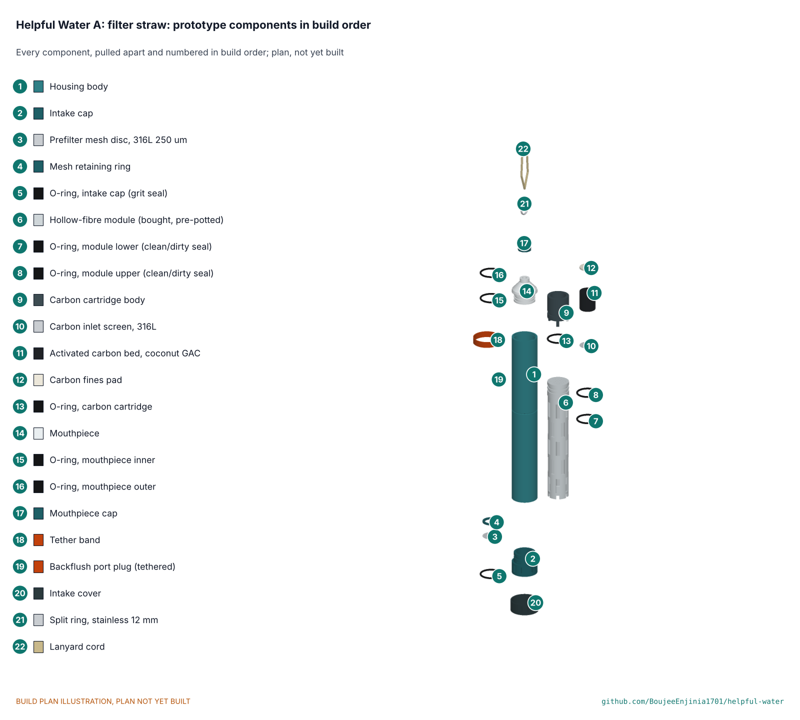

A drinking straw 205 mm long and 26 mm across with 22 components. Eight are made: the housing, intake cap, mesh ring, carbon cartridge cup, mouthpiece and mouthpiece cap are printed in polypropylene, and the socket plug with its band and the intake cover are cast in silicone. The rest are bought: the pre-potted hollow-fibre module (the only specialist part), a stainless mesh disc and screen, six O-rings, the carbon and its pad, a split ring, a cord and a 20 mL syringe. Nothing is glued and nothing is potted by the builder; the joints are O-rings, press fits and quarter-turn bayonets. Parts cost about USD 17.

## 2. What changed to make it buildable

| Component | The concept had | The buildable design has | Why |
| --- | --- | --- | --- |
| O-rings | 20 x 2 mm rings | 18.77 x 1.78 mm rings (AS568-018) in grooves with a 19.3 mm floor | A 20 x 2 mm ring is 24 mm across and cannot enter the 22 mm bore |
| Membrane | 40 to 80 fibres round a central permeate tube | About 220 fibres filling the bore, open only at the top into a clean header; no central tube | Rev A's fibres give a quarter of the flow needed |
| End joints | Not drawn | Quarter-turn bayonets inside the bore | A thread on a 2 mm wall is too weak or makes the straw too fat |
| Module stop | Not drawn | A ring inside the housing, 22 to 24 mm from the intake end | The module needs something to stand on |
| Header | Not dimensioned | A 6 mm space held open by three legs under the carbon cup | The carbon cup must not sit on the fibre ends |
| Backflush port | "Luer or barb, to choose" | A short tapered socket on the header with a tethered silicone plug | Keeps the straw under 30 mm across |
| Mouthpiece cap | Plain cap | A cap with a small plug that closes the mouthpiece bore | Closing the outlet keeps backflush water out of the carbon |
| Carbon | 5 g | 2 g, which is what a 16 x 20 mm bed holds | Arithmetic from the carbon's density |

## 3. Making the components

### 3.1 Housing body

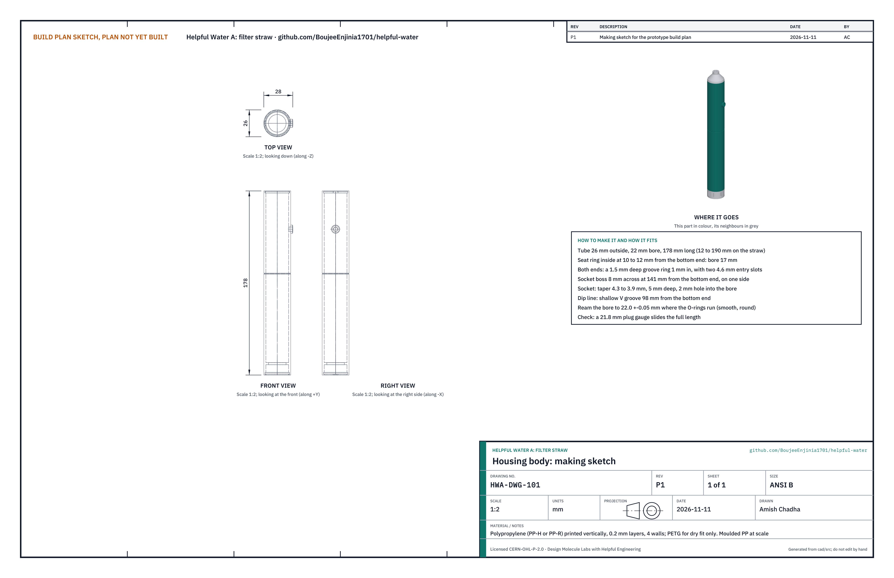

**What it is and what it is made from.** The main tube that holds everything: 26 mm outside, 22 mm bore, 178 mm long. Printed in polypropylene for a working prototype; PETG is fine for dry fitting only.

**How to make it.**

1. Print it standing upright, 0.2 mm layers, four perimeters, so the bore is round and the seat ring prints as a ledge.
2. Check that both bayonet groove rings (1 mm in from each end, 1.5 mm deep) and their two entry slots printed clean; clear any strings with a hobby knife.
3. Ream or turn the bore to 22.0 +- 0.05 mm for the first 15 mm at each end and over the band 128 to 140 mm from the bottom end, where O-rings run, and check it with calipers at two angles. A rough or oversize bore leaks past an O-ring; as printed (+- 0.1 mm) the squeeze can fall to 15 % (HWA-DEC-001 F9).
4. Open the socket on the boss with a 4 mm drill turned by hand, then a tapered reamer, to a taper of 4.3 mm at the mouth falling to 3.9 mm at 5 mm deep; clear the 2 mm hole through into the bore.

**How it fits the parts next to it.** The intake cap and the mouthpiece push into its ends and lock with a quarter turn. The module slides in from the top and stands on the seat ring. The plug band rolls onto its outside.

**Check before moving on.** A 21.8 mm round gauge (or the module collar itself) slides the full length without catching. Hold the housing up to the light: no pinholes through the wall.

### 3.2 Intake cap

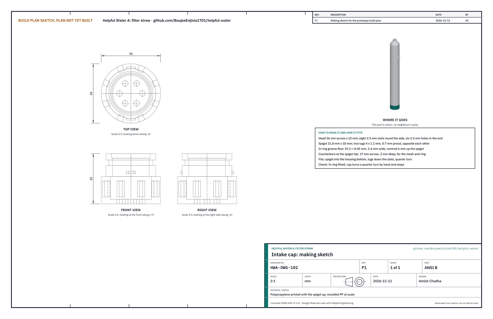

**What it is and what it is made from.** The end that goes in the water: a head 26 mm across and 12 mm tall with eight slots round the side and six holes in the end, and a 21.8 mm spigot that goes into the housing. Polypropylene, printed spigot up.

**How to make it.**

1. Print it with the spigot pointing up so the two bayonet lugs (4 mm wide, 0.7 mm proud) print without support.
2. Clean the O-ring groove (floor 19.3 mm, 2.4 mm wide) so its floor is smooth and round.
3. Check the 17 mm counterbore at the spigot top is 2 mm deep and flat.

**How it fits the parts next to it.**

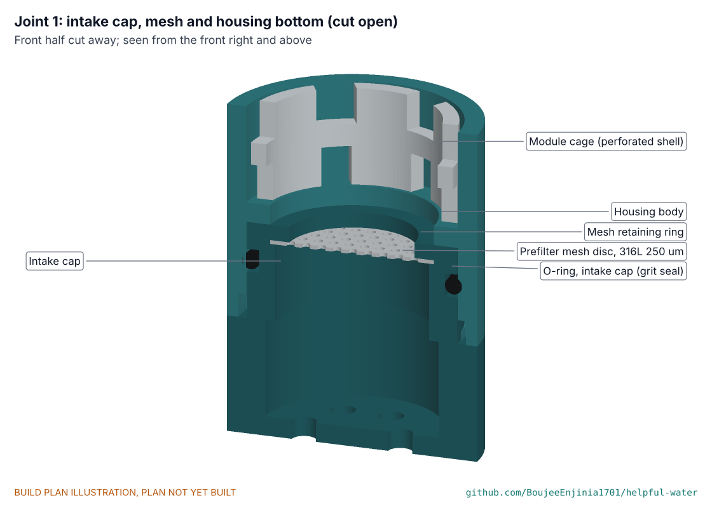

The mesh disc lies flat in the counterbore and the retaining ring presses in on top of it. The cap's O-ring seals against the housing bore, so grit cannot go round the mesh. The lugs go down the entry slots and a quarter turn locks them in the groove ring.

**Check before moving on.** With its O-ring on, the cap goes in and turns a quarter turn by hand, stops, and does not drop out when the housing is shaken.

### 3.3 Mesh retaining ring

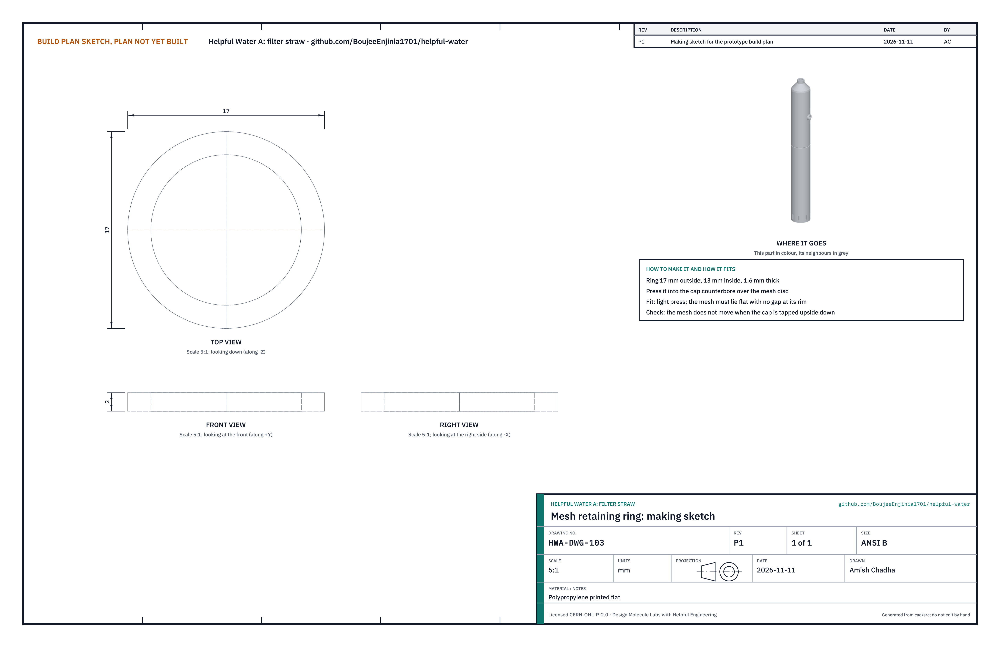

**What it is and what it is made from.** A flat ring 17 mm outside, 13 mm inside and 1.6 mm thick that holds the mesh disc in the cap. Polypropylene, printed flat.

**How to make it.** Print flat; sand the outer edge until it is a light press fit in the cap counterbore.

**How it fits the parts next to it.** It presses down on the rim of the mesh disc, which keeps the mesh flat and captive when the cap is taken off for rinsing.

**Check before moving on.** Tap the cap upside down on the bench: the mesh does not move.

### 3.4 Carbon cartridge cup

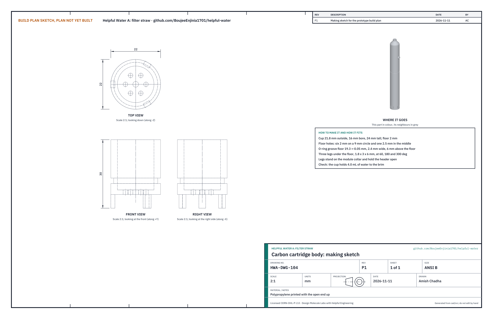

**What it is and what it is made from.** A cup 21.8 mm outside and 24 mm tall with a 16 mm bore, a floor with seven holes, one O-ring groove and three short legs underneath. Polypropylene, printed open end up.

**How to make it.**

1. Print open end up; the three legs (1.8 x 3 mm, 6 mm long) print as posts under the floor, so print the cup on a raft or turn it over and print it floor up with the legs on top.
2. Clear the floor holes (six of 2 mm, one of 2.5 mm in the middle).
3. Clean the groove (floor 19.3 mm, 2.4 mm wide, centred 6 mm above the floor).

**How it fits the parts next to it.**

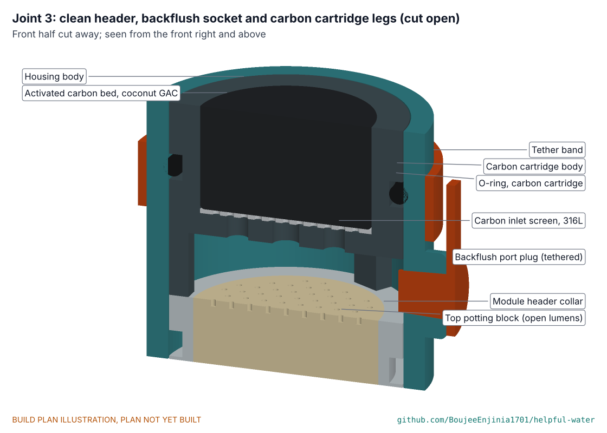

The legs stand on the top of the module collar and hold a 6 mm clean space (the header) above the fibre ends. The backflush socket opens into that space, between two legs. The cup's O-ring seals against the bore above the socket.

**Check before moving on.** Fill the empty cup with water: it holds 4.0 mL to the brim (a syringe tells you).

### 3.5 Mouthpiece

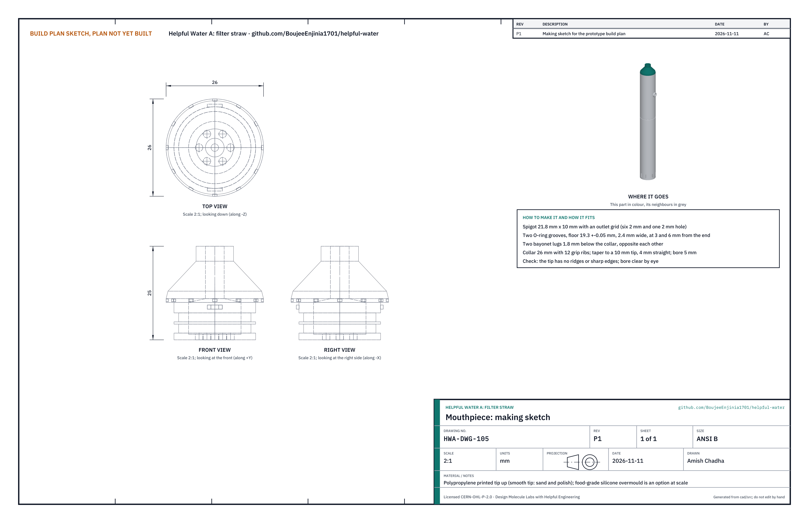

**What it is and what it is made from.** The part you drink from: a 21.8 mm spigot with an outlet grid, two O-ring grooves and two bayonet lugs; a 26 mm collar with grip ribs; a taper to a 10 mm tip with a 5 mm bore. Polypropylene, printed tip up.

**How to make it.**

1. Print tip up so the taper prints without support.
2. Sand and polish the tip until there are no layer ridges or sharp edges where lips touch it.
3. Clean both grooves (3 and 6 mm from the spigot end), turn or sand their floors to 19.3 +- 0.05 mm (HWA-DEC-001 F9) and blow the bore clear.

**How it fits the parts next to it.**

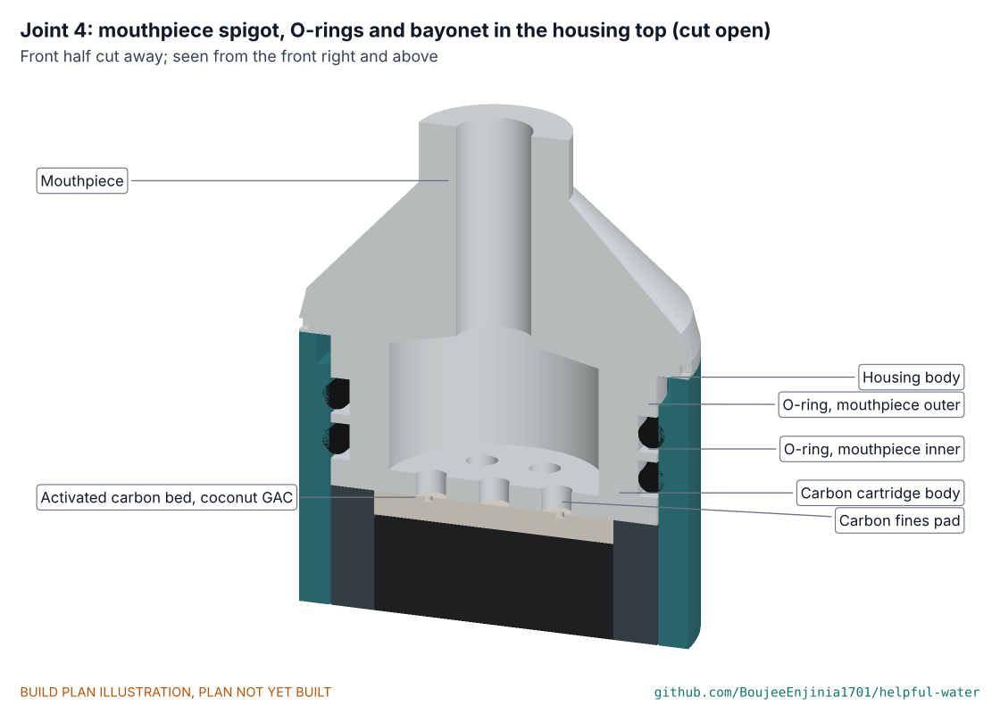

The spigot pushes into the housing top until its end rests on the carbon pad, and a quarter turn locks the lugs. Its two O-rings seal the clean side from the outside.

**Check before moving on.** Look down the bore against the light: clear. Run a fingertip and lip over the tip: smooth.

### 3.6 Mouthpiece cap

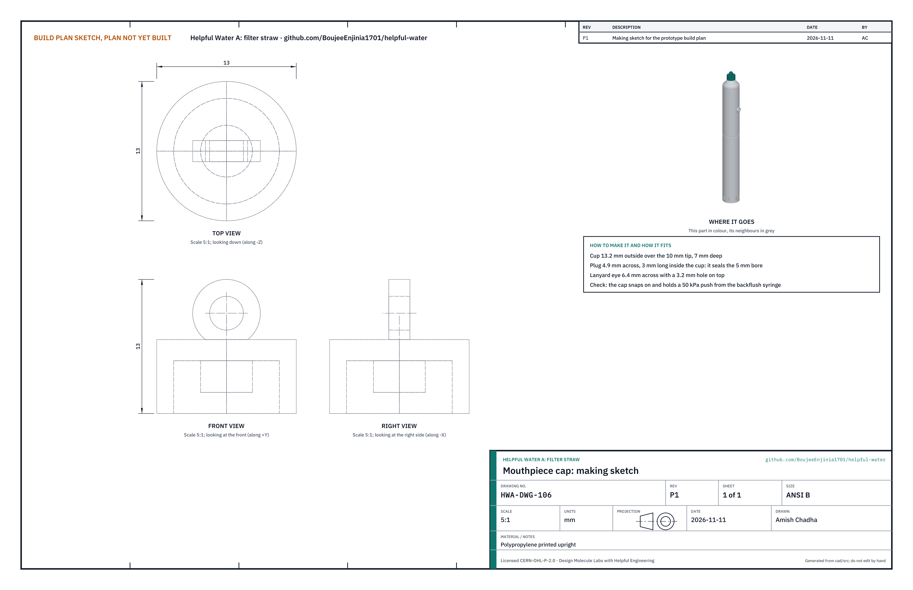

**What it is and what it is made from.** A snap cap over the 10 mm tip with a 4.9 mm plug inside that closes the bore, and an eye on top for the lanyard. Polypropylene, printed upright.

**How to make it.** Print upright; sand the plug until it pushes into the bore with a firm click and seals.

**How it fits the parts next to it.** It snaps over the tip. Its plug is what keeps backflush water out of the carbon, so it must seal.

**Check before moving on.** With the cap on, blow gently into the intake end with the socket plugged: no air leaks at the cap.

### 3.7 Backflush plug and tether band

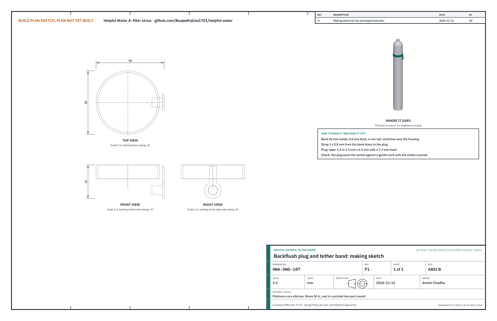

**What it is and what it is made from.** A silicone band that rolls onto the housing above the socket, with a short strap down to a tapered plug for the socket. Platinum-cure silicone, Shore 50 A, cast in a printed two-part mould.

**How to make it.**

1. Print the two mould halves from the plug-and-band shape; spray them with release agent.
2. Mix and degas the silicone; pour; close the mould; cure to the maker's time.
3. Trim the flash with scissors.

**How it fits the parts next to it.** The band stretches over the 26 mm housing just above the socket; the plug pushes into the socket and seals on its taper.

**Check before moving on.** With the plug in and the intake end closed by a finger, a gentle suck on the mouthpiece holds without leaking at the plug.

### 3.8 Intake cover

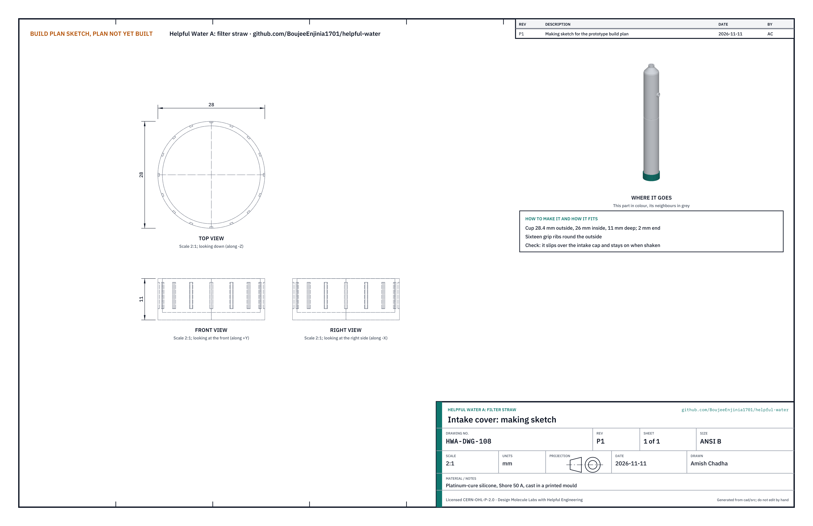

**What it is and what it is made from.** A silicone cup 28.4 mm across that slips over the intake cap for carrying. Cast like the plug and band.

**How to make it.** Cast in a printed mould; trim.

**How it fits the parts next to it.** It slides over the intake cap head and grips its outside.

**Check before moving on.** Shake the straw: the cover stays on.

### 3.9 Bought components

- **Hollow-fibre module.** Pre-potted, outside-in, about 220 fibres 0.8 mm across with 0.5 mm bores, about 102 mm active, the far ends closed in the bottom potting and the bores open at the top potting, inside a collar 21.8 mm across with two O-ring grooves (floor 19.3 mm). The supplier states the pore rating, clean-water flow at 20 C, integrity test and maximum backflush pressure. If the collar has no grooves, cut them on a lathe with a 2.4 mm parting tool, 1.25 mm deep, at 6.5 and 10.5 mm from the collar's lower edge; take care not to cut into the potting. Keep the module wet or sealed as the supplier says.
- **Mesh disc.** Woven 316L, 250 um aperture, a 17 mm disc (150 and 350 um discs for comparison). Deburr the edge.
- **Carbon inlet screen.** Woven 316L, 150 um, a 16 mm disc.
- **O-rings.** Six AS568-018 (18.77 x 1.78 mm), EPDM, drinking-water listed. Wipe on a thin film of food-grade silicone grease.
- **Carbon.** Coconut-shell granular activated carbon, 12 x 40 mesh, drinking-water grade: 2.0 g per cartridge. Rinse it in known potable test water until the rinse runs clear, and drain.
- **Fines pad.** Non-woven polypropylene, about 20 um, cut to a 16 mm disc.
- **Split ring, cord and syringe.** A 12 mm stainless split ring, 450 mm of 2 mm polyester cord, and a 20 mL luer-slip syringe.

## 4. Putting it together

### Step 1: seat the two O-rings on the module collar

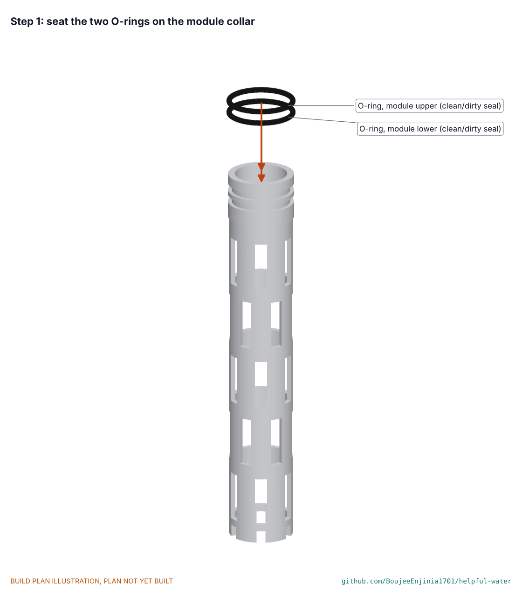

Roll each O-ring over the collar into its groove; do not let it twist. These two rings are the seal between the dirty side and the clean side: check by eye that both sit evenly all round. **Hold point:** no nick or twist in either ring.

### Step 2: slide the module into the housing

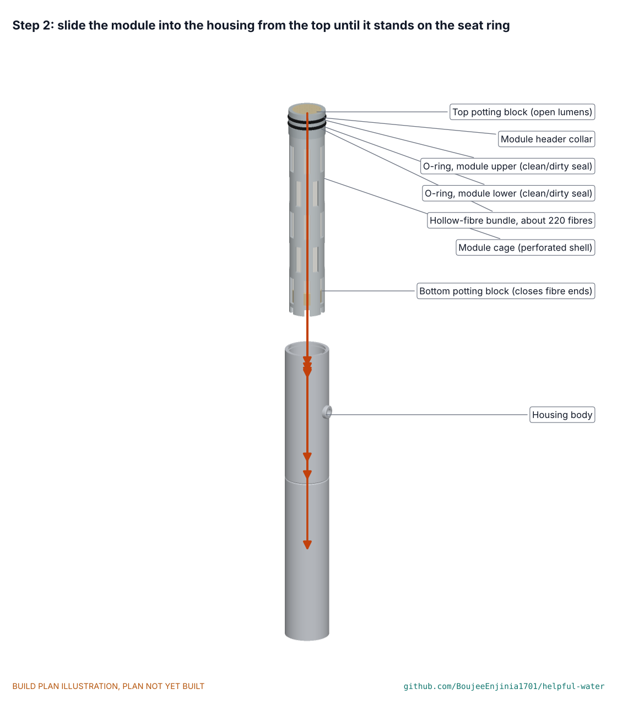

With the collar end up, push the module into the top of the housing and slide it down until its feet stand on the seat ring. Push gently and straight; the O-rings must not roll out of their grooves at the end of the bore.

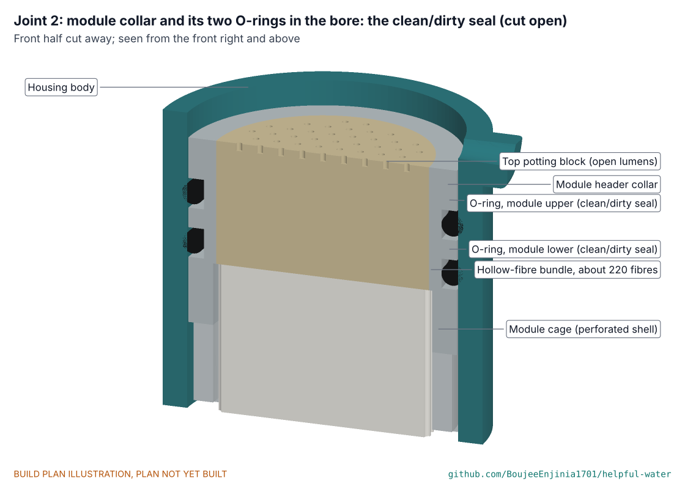

The two O-rings now sit about 130 and 134 mm up from the housing's bottom end, where the bore was reamed smooth; dirty water is below them and the clean header above.

### Step 3: fill the carbon cartridge

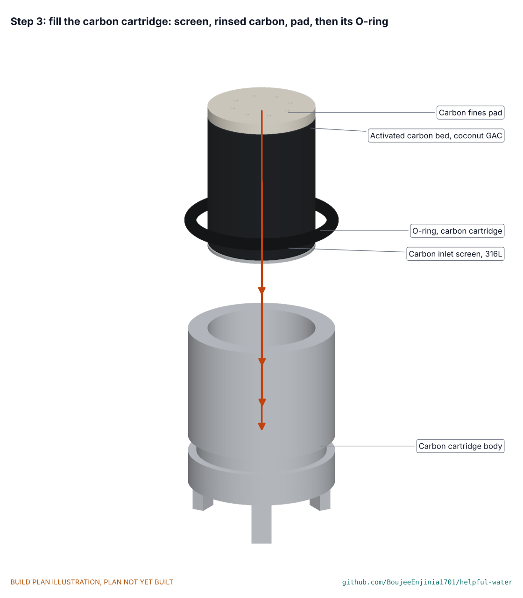

Drop the 150 um screen into the cup, pour in 2.0 g of the rinsed carbon, tap the cup to settle it, lay the fines pad on top and roll the O-ring into the groove.

### Step 4: push the carbon cartridge in

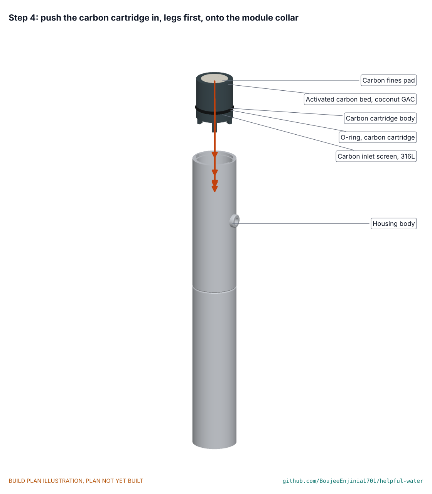

Push the cup into the housing top, legs first, until the legs stand on the module collar. The backflush socket must open between two legs: turn the cup so a gap faces the socket.

### Step 5: fit the mouthpiece

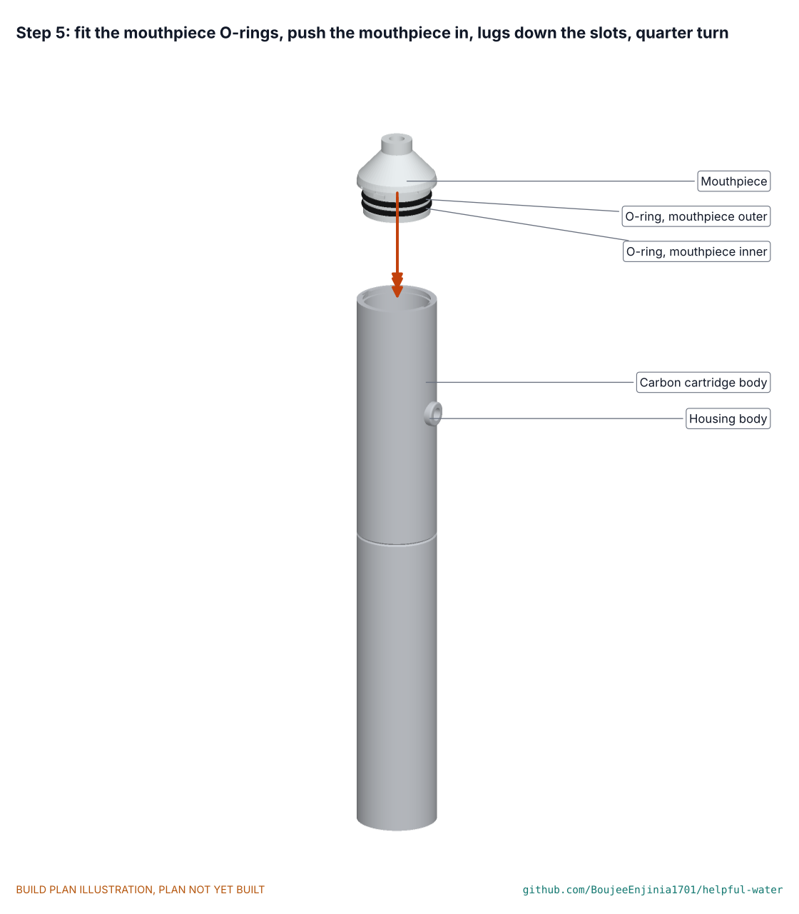

Roll its two O-rings into their grooves, push the mouthpiece in with its lugs lined up with the entry slots, and turn it a quarter turn until it stops. Its end now rests on the fines pad and holds the cartridge down.

### Step 6: fit the mesh and the intake cap

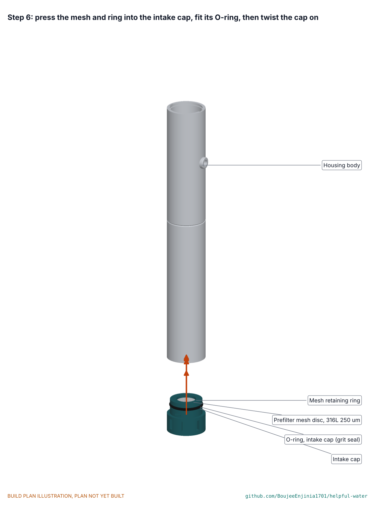

Lay the mesh disc flat in the cap's counterbore, press the retaining ring on top, roll the cap's O-ring into its groove, push the cap into the housing bottom with its lugs in the slots and turn it a quarter turn.

### Step 7: fit the plug band

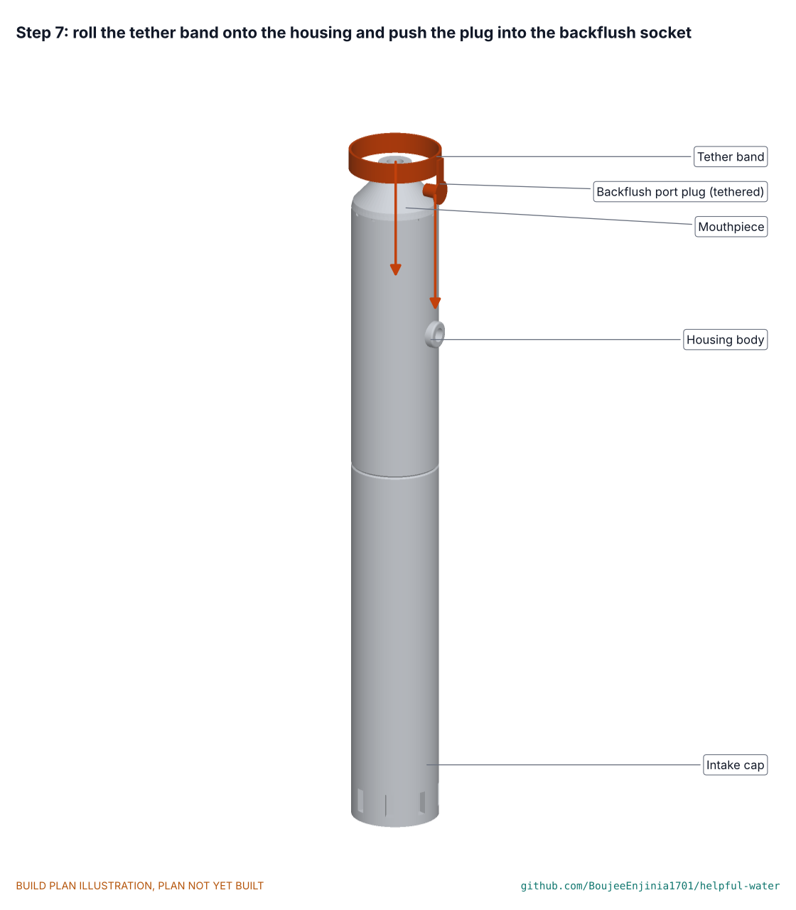

Roll the silicone band onto the housing just above the socket and push the plug into the socket.

### Step 8: caps and lanyard

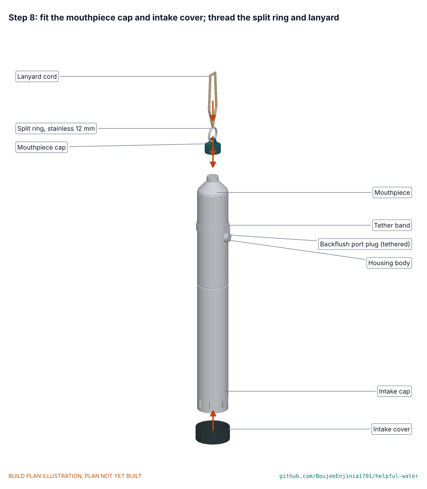

Snap the mouthpiece cap on, slip the intake cover over the intake cap, thread the split ring through the cap's eye and knot the cord to it.

## 5. First checks

These are listed here and recorded in a TRL 4 test report, never in this plan. All with known potable test water only.

| Check | Requirement | How | Pass when |
| --- | --- | --- | --- |
| Bore and fit | PR-007 | Dry fit every bayonet; turn each quarter turn | Every joint locks and does not drop apart |
| Dip line | PR-028 | Measure from the intake face | Groove at 110 mm, below the socket at 153 mm |
| Seal hold | PR-007 | Wet the module; plug the socket; cap the mouthpiece; push 20 mL of air into the intake end through a fitting at about 50 kPa | No air at the mouthpiece joint, plug or cap |
| Air check | PR-012 | Wet straw, cap on; push 20 mL of air from the syringe into the socket to the 6 mL mark and hold 10 s; then invert under known potable test water to look for bubbles; repeat with one collar O-ring left out to see a known fail | Plunger holds; no steady bubble stream from the intake; the known fail shows |
| Backflush route | PR-014 | Cap on; push 20 mL of coloured known potable test water into the socket | Colour leaves at the intake; none at the mouthpiece |
| First flow | PR-002, PR-003 | Suction from a hand vacuum pump with a gauge at 5 and 10 kPa | Recorded flow primed and with an air pocket, compared with 110 to 179 mL/min at 10 kPa (HWA-CAL-001 section 4.2) |
| Size and mass | PR-019, PR-027 | Calipers and scale | Under 250 x 30 mm and 100 g |

## 6. Safety stops

- **Before any water goes in:** every made part is checked, the module is from a supplier with a certificate, and only known potable test water is on the bench. Stop if the source of the test water is unknown.
- **Before any suction:** use a hand vacuum pump, never a mouth, for every flow check; nobody drinks from the prototype.
- **Before backflush or the air check:** the module's maximum reverse pressure is known and the push stays below it (a firm 60 N push on a 20 mL syringe makes about 190 kPa); stop if it is not known. Fill the syringe only with known potable test water.
- **After a drop or a freeze:** stop and retire the module until the air check has been validated by the laboratory.
- **Before showing it to anyone:** the virus warning and the release limitation are on the straw and on the bench.

## 7. Tools, skills and workspace

An FDM printer that prints polypropylene (or PETG for dry fit), calipers, a 4 mm drill and a small tapered reamer turned by hand, fine sandpaper, a hobby knife, food-grade silicone grease, a scale reading to 0.1 g, a hand vacuum pump with a gauge, two printed moulds and platinum-cure silicone, and access to a lathe if the module collar needs grooves. Skills: careful printing and finishing, O-ring fitting, simple silicone casting. A clean bench with known potable test water.

## 8. Where the numbers come from

- Model: `cad/src/model.py` (option A1), STEP files in `cad/step/A1/` and `cad/step/A1-assembly.step`.
- Drawings: `cad/drawings/HWA-DWG-001` (general arrangement), `HWA-DWG-002` (half section), `HWA-DWG-101` to `108` (making sketches).
- Calculations: HWA-CAL-001 (`docs/04-calcs/01-sizing.md`, `sizing.py`).
- Parts: `bom/bom.csv`.
- Decisions: HWA-DEC-001, HWA-DDR-002, HWA-DDR-003.

Licence: this document is licensed under CC-BY-4.0 (Creative Commons Attribution 4.0 International), following the Helpful Engineering licensing guide. Design Molecule Labs with Helpful Engineering.
