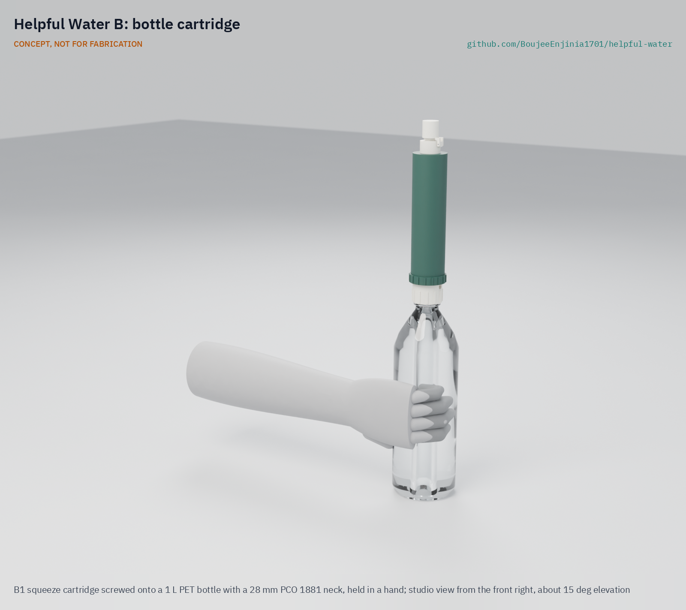
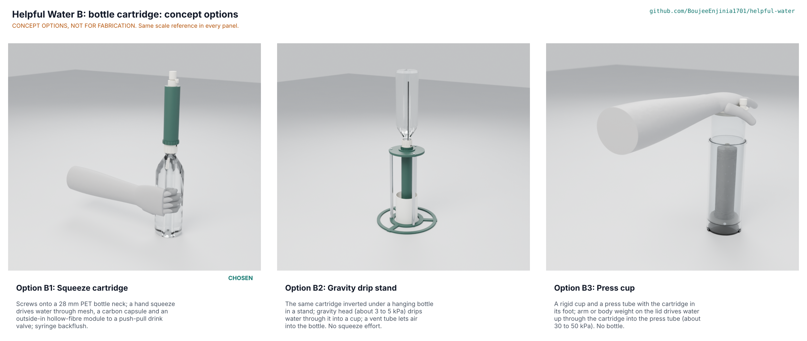
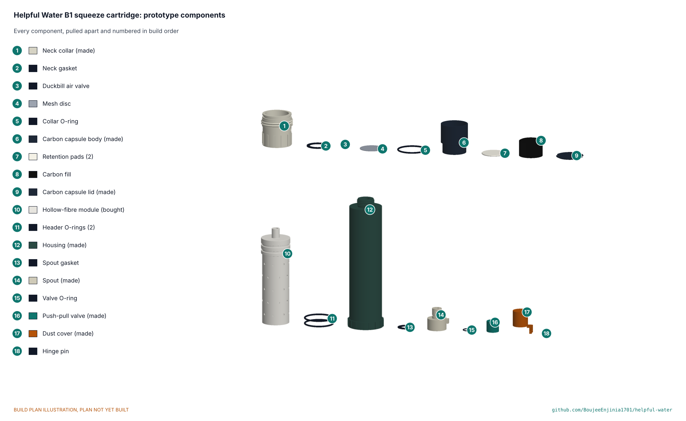

# Helpful Water B: bottle cartridge



CONCEPT, NOT FOR FABRICATION. [Studio view](media/render-studio.png) · [Exploded render](media/render-exploded.png) · [Concept render](media/hero.png)

    

**Area:** Food and water security · **TRL:** 3 of 9 (proof of concept on paper) · **Value-engineering target:** USD 20 of prototype parts · **Difficulty:** 2 of 5

A screw-on cartridge that turns a standard 28 mm PET bottle into a squeeze filter designed to reduce bacteria and protozoa: a steel mesh, a replaceable carbon capsule and a bought hollow-fibre module, backflushed with a syringe. It is not a virus barrier, so where viruses are a risk the water is also treated with chlorine (solution D).

> **Release limitation.** Nothing here is a validated water treatment product. No prototype is used to treat water for drinking until its pathogen performance, materials safety, integrity, source suitability and claims are validated by qualified laboratories (HWP-CLM-001).

[Interactive 3D model](media/viewer.html) · [Concept blueprint (PDF)](media/concept-blueprint.pdf) · [General arrangement HWB-DWG-001 (PDF)](cad/drawings/HWB-DWG-001.pdf) · [Section HWB-DWG-002 (PDF)](cad/drawings/HWB-DWG-002.pdf) · [Sizing note HWB-CAL-001](docs/04-calcs/01-sizing.md) · [STEM check](docs/01b-stem-check.md) · [Concept options](docs/02a-concept-options.md) · [Prototype build plan](docs/05-build-plan.md) · [Decisions](docs/06-design-decisions.md) · [Review note](docs/REVIEW.md)

## Concept rationale

Most people who need a filter already have a plastic bottle. A cartridge that fits the bottle's own neck uses that container as the pump, can fill a cup for a child without passing a mouthpiece around, and leaves only a small part to make, ship and replace. The viability shortlist scored this idea 40 of 50, joint top, for that reason. Solution B keeps the mechanism minimal: one squeeze, one membrane, one seal line between dirty and clean water, and a carbon capsule a user can refill.

Design thesis: **simple and honest**: one seal line, one check a user can do (squeeze air through it), no claim beyond the tests.

## Burning platform

- 2.1 billion people lack safely managed drinking water and 106 million drink untreated surface water (WHO and UNICEF, 2025, cited in HWP-PRB-001).
- Contaminated drinking water causes about 505,000 diarrhoeal deaths a year (WHO fact sheet, cited in HWP-PRB-001).
- Commercial squeeze filters cost USD 17 to 46 (Sawyer, checked 2026-11-11), are closed designs, and cannot be made or resupplied regionally (HWB-MKT-001).

## Where it could be used

### By industry

| Industry | Use |
| --- | --- |
| Humanitarian response | Emergency kits for flood and displacement response, with chlorine co-treatment |
| Education | Schools with stored or unimproved water, filling cups |
| Regional plastics manufacture | Housings and collars printed or moulded locally |
| Outdoor retail | A funding channel that cross-subsidises humanitarian units |

### By country or region

| Country or region | Why it matters there |
| --- | --- |
| Fragile and least developed countries | Safely managed water coverage is 38 points lower in fragile contexts (HWP-PRB-001) |
| Camps and host communities | Stored water is recontaminated in handling; treatment at the time of drinking reduces the risk (HWP-URS-001 use case 3) |
| Regions where PET bottled water is common | The neck finishes the collar fits are already in every household |

## What sparked the idea

The Helpful Engineering Infectious Disease Challenge viability shortlist (item 9) proposed a "modular screw-on cartridge" that turns a plastic bottle into a long-life filter, and the Helpful Water team's review of the filter straw asked whether a straw is the right unit at all, since it serves only the person sipping (HWP-PRB-001). Solution B is that cartridge, worked through the Design Molecule pipeline.

## Problem

Families, schools and camps need a personal filter that costs little, works with the bottles they already have, lasts 6 to 12 months and has a consumable they can resupply ([HWB-PRB-001](docs/01-problem.md)). Design with, not for: these needs are a desk draft to review with users through a field partner.

## Concept

Squeezing the bottle pushes water through a 150 um 316L mesh, a 6.8 g bed of coconut-shell carbon in a capsule on the dirty side, and the outside of 400 looped hollow fibres (0.1 um, about 0.17 m2) in a bought pre-potted module; the water runs out of the fibre lumens through the potting, past two header O-rings that are the only dirty-to-clean seal, to a push-pull valve with a dust cover. A duckbill valve lets air back into the bottle. When the flow drops, the user lifts out the carbon capsule and pushes two syringes of treated water back through the nozzle ([HWB-PRC-001](docs/02-concept.md)).

## Concept options

Three working principles were modelled at detail level D3 and scored ([HWB-OPT-001](docs/02a-concept-options.md)): **B1 squeeze cartridge (246 of 310)**, **B2 gravity drip stand (222)** and B3 press cup (209). B1 and B2 are within 10 %, so both went to Amish, who chose B1 on 2026-11-11 (HWB-DEC-001 D1); B1 is carried to the drawings, BOM and build plan. None of the options uses the suction and inside-out flow of claim 1 of US 8,852,439 B2 (HWB-OPT-001; not legal advice). The options picture is rendered in Blender (`media/options.png`).



## STEM check

No claim fails; 14 of 33 sit within known science and 19 stay open for supplier data and TRL 4 tests ([HWB-STM-001](docs/01b-stem-check.md)). Four details of the briefed options failed and were fixed under Amish's standing instruction: the carbon moves upstream of the membrane so no wet carbon sits on the clean side; a duckbill lets air back into a squeezed bottle; the gravity stand gets a wider base; and its inverted bottle gets a vent tube. An independent reviewer (a separate agent that saw only the claims, calculations and sources) then found 10 rows that hold, 16 weak and 1 refuted, plus 11 missed checks. That led to five more fixes: refill with the bottle upright, a 50 mL first flush after storage because the lumens stay wet, chlorine dosed and left for its full contact time before filtering (the carbon removes the residual), priming by backflush, and a fuller module request. Two proposals went to Amish: the housing end wall (D8) and the rating temperature (D9). Estimates (HWB-CAL-001), clean module, 20 C water, at an **assumed** membrane permeability that the module maker must confirm:

| Quantity | Value |
| --- | --- |
| Flow, adult held squeeze (17 kPa) | 465 mL/min (242 before a backflush is due) |
| Flow, weak child (5.8 kPa) and weak elderly woman (7.2 kPa) | 160 and 198 mL/min (82 and 102 fouled) |
| Flow in 10 C water | About 23 % lower: 360 mL/min adult, 123 weak child |
| Pressure taken by mesh, carbon, lumens and outlet at 17 kPa | 1.1 kPa in all; the fibre walls take the rest |
| Carbon contact time | 1.8 to 5.2 s; chlorine taste is a target only |
| Air check | Shows any opening above about 17 um at an adult squeeze; not a proof of performance |
| Wet clean side | About 21 mL (15.2 mL in the lumens stays wet); 50 mL first flush after storage |
| Size and mass | 217 x 46 mm, about 118 g dry, 182 g wet |
| Prototype parts | USD 18.35 (USD 1.65 under the USD 20 target) |
| Cost over life | USD 0.015 a litre; USD 10.8 per user per year at 9 months (over the USD 10 target), USD 8.5 at 12 months |

## Key components

Printed polypropylene collar (28 mm PCO 1881 thread, also fits PCO 1810; 38 mm wide-mouth necks by an adapter), housing, carbon capsule and lid, spout, push-pull valve and dust cover; a bought pre-potted hollow-fibre module; coconut-shell GAC; 316L mesh; EPDM or silicone O-rings and gaskets; a silicone duckbill; a stainless hinge pin; a 60 mL backflush syringe ([bom/bom.csv](bom/bom.csv), 18 lines).

## Building the prototype

The [prototype build plan](docs/05-build-plan.md) (HWB-BLD-001) shows how to print the seven polypropylene parts, fit the bought module and seals without glue or potting, and assemble the cartridge in nine steps, with a picture for every part and step and first checks with known potable test water only. It is a plan, not yet built.



## Safety

Treat every prototype as unproven and test it only with known potable test water. Do not freeze it wet; retire it after freezing, a hard drop or a stream of bubbles in the air check. Backflush only with treated water and a gentle syringe push, capsule out, pointed away from the face. Never use it on flood or runoff, salt or chemically contaminated water, and settle turbid water first. It does not remove viruses or dissolved chemicals. This is a TRL 3 concept, not released for fabrication.

## Claims and limits

From [HWP-CLM-001](../../docs/12-claims.md):

- **May say now:** "Designed to reduce bacteria and protozoa in clear freshwater"; "carbon stage intended to improve taste and odour."
- **Only after accredited, independent testing:** a measured log reduction for named bacteria and cyst surrogates at stated flow, turbidity and life; a taste or chlorine reduction under NSF/ANSI 42.
- **Never say:** "purifies", "sterilises", "virus-proof", "makes any water safe", "removes all contaminants".
- **On-product warning:** "Reduces bacteria and protozoa. Does not remove viruses. Where viral disease is a risk, also treat the water with chlorine (solution D or a WHO-recommended tablet)," with the crossed-out virus and tablet pictogram.
- **Exclusions:** viruses, salt, arsenic, nitrate, fluoride, lead, PFAS, pesticides, fuel and industrial chemicals; do not freeze when wet.
- **Release limitation:** no prototype is used to treat water for drinking until pathogen performance, materials safety, integrity, source suitability and claims are validated by qualified laboratories.

## Helpful Engineering

Solution B is one of four lettered solutions in Helpful Water, a joint program of Design Molecule Labs and Helpful Engineering's Infectious Disease Challenge. It shares the program problem, source classes, user requirements, claims, regulatory, market, verification and patent documents in [`docs/`](../../docs/) and is described in the [program README](../../README.md). Solution D, the chlorine add-on, is the co-treatment B pairs with where viruses are a risk.

## Repository layout

```
docs/                       controlled documents (PRB, STM, OPT, PRC, URS, PRS, RTM, CAL, BLD, DEC, REG, FEA, RSK, MKT, PLN) and REVIEW.md
docs/04-calcs/              sizing.py (HWB-CAL-001), stem_check.py, stm_table.py, results
docs/decisions/             decision records (concept selection, design for construction, STEM fixes)
docs/05-build-plan/         build plan pictures
cad/src/model.py            parametric model, options B1 to B3 at detail level D3 (kit 1.9)
cad/src/hw_parts.py         threads, O-rings, gaskets, mesh, fibre bundle, carbon bed, PET bottle, small screws
cad/src/sheets.py           drawings HWB-DWG-001 and 002, STL export
cad/src/build_plan_media.py build plan pictures and making sketches HWB-DWG-101 to 107
cad/src/concept_media.py    hero, cutaway, exploded, flow, 3D viewer, concept blueprint
cad/src/product_model.py    appearance model and render views (Blender)
cad/step/, cad/stl/, cad/drawings/   exports
bom/bom.csv                 priced bill of materials (B1)
.kit/                       shared documentation kit 1.9.1-he (do not edit here)
```

## Documentation

Controlled documents follow the portfolio standards in [.kit/STANDARDS.md](.kit/STANDARDS.md), including the Helpful Engineering profile (section 25). From this folder run `python .kit/render.py --check`, `python .kit/cad_check.py --export`, `python docs/04-calcs/sizing.py`, `python docs/04-calcs/stem_check.py` and `python .kit/trace.py`.

## Credits

Amish Chadha, Ali Raza, Suraksha Bhat, Lillian Fernandes, Raksha Thammaiah and James Butler (Design Molecule Labs with Helpful Engineering). AI assistance (Claude) was used to accelerate research, calculations, CAD and documentation; design direction and all decisions are Amish Chadha's, recorded in [docs/06-design-decisions.md](docs/06-design-decisions.md).

## Licenses

Following the [Helpful Engineering licensing guide](https://helpfulengineering.org/licensing-guide/):

- Hardware (CAD sources, STEP, drawings, BOM, build plan pictures): CERN-OHL-P-2.0, [`../../LICENSE-HARDWARE.txt`](../../LICENSE-HARDWARE.txt)
- Software (calculation and kit scripts, web viewer): Apache-2.0, [`../../LICENSE-SOFTWARE.txt`](../../LICENSE-SOFTWARE.txt)
- Documentation (controlled documents, README, renders): CC-BY-4.0, [`../../LICENSE-DOCUMENTATION.txt`](../../LICENSE-DOCUMENTATION.txt)

---

Design Molecule Labs with Helpful Engineering
