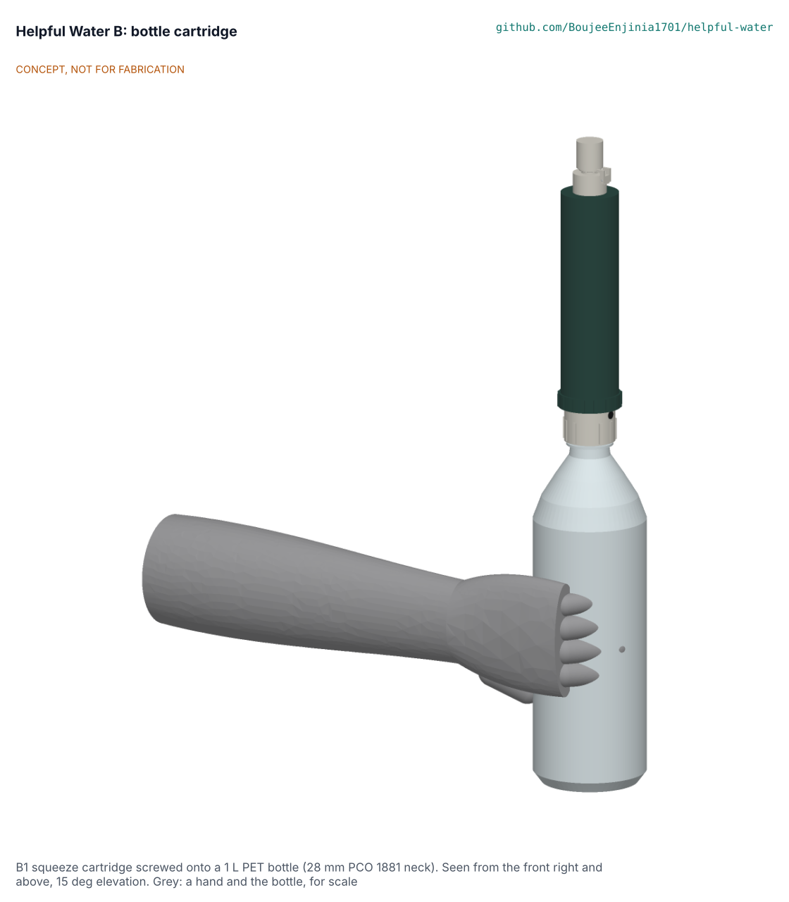

# Helpful Water B: bottle cartridge design precis

The B1 cartridge screws onto a standard 28 mm PET bottle and, when the bottle is squeezed, pushes the water through a steel mesh, a carbon capsule and a hollow-fibre membrane to a drink valve; it is designed to reduce bacteria and protozoa and is not a virus barrier. The concept choice between B1 and the B2 gravity stand is Amish's (HWB-OPT-001, HWB-DEC-001 D1); B1 is the design carried to the TRL 3 drawings, BOM and build plan.

> **Release limitation.** No prototype is used to treat water for drinking until its pathogen performance, materials safety, integrity, source suitability and claims are validated by qualified laboratories (HWP-CLM-001). On the product: "Reduces bacteria and protozoa. Does not remove viruses. Where viral disease is a risk, also treat the water with chlorine (solution D or a WHO-recommended tablet)."

## How it works

1. The user fills a 1 L PET bottle, screws the cartridge on, tips the bottle and squeezes.
2. Water rises through the collar's 18 mm inlet and a 150 um 316L mesh disc that holds back grit.
3. It passes a 13.9 mL bed of coconut-shell granular carbon (about 6.8 g) in a replaceable capsule, on the dirty side of the membrane, intended to improve taste and odour.
4. It reaches the outside of 400 looped hollow fibres (0.1 um, about 0.17 m2) in a bought, pre-potted module, passes the fibre walls from outside in, and runs along the lumens to the potting at the clean end.
5. Two O-rings on the module header are the only seal between dirty and clean water. The clean water leaves through a 10 mm nipple, the spout and a push-pull valve, to the mouth or into a cup.
6. On release a duckbill valve in the collar lets air back into the bottle, so it springs back without unscrewing.
7. Daily: drain and dry. When flow drops, unscrew the housing, lift out the carbon capsule and push two 60 mL syringes of treated water back through the nozzle; the dirt leaves through the open collar end, never through the carbon.

## Main components

Collar with a PCO 1881 female thread and the duckbill; housing; carbon capsule and lid; spout, push-pull valve and dust cover with a stainless hinge pin (all polypropylene, printed for the prototype, moulded at scale); bought hollow-fibre module, coconut GAC, 316L mesh, EPDM or silicone O-rings and gaskets, and a 60 mL syringe (`bom/bom.csv`, 18 lines).

## Key design choices (proposed, awaiting Amish unless stated)

- Carbon upstream of the membrane, on the dirty side, so the membrane is the last barrier and backflush never passes the carbon: decided under the standing instruction of 2026-10-23 (F1), because the briefed downstream carbon would grow bacteria on the clean side (HWB-STM-001 S18).
- A duckbill air valve in the collar: decided under the standing instruction (F2), because a wetted membrane blocks air and a squeezed bottle would otherwise stay crushed (S19).
- Outside-in flow with looped fibres potted at the outlet: keeps the pressure on the shell side, gives a field air test, and is the reverse of the arrangement in claim 1 of US 8,852,439 B2 (HWB-OPT-001).
- A bought pre-potted module rather than in-house potting (Rev A build-versus-buy rule).
- Push-pull valve and dust cover: cup filling for shared use, and a cover against hand and mouth contamination of the clean outlet.

## First-order numbers (HWB-CAL-001, estimates)

| Quantity | Value | Assumption |
| --- | --- | --- |
| Flow, adult held squeeze 17 kPa | 465 mL/min clean, 242 fouled | Permeability 1,000 L/(m2 h bar) assumed |
| Flow, weak child 5.8 kPa | 160 mL/min clean, 82 fouled | Grip norms; 40 % held |
| Stage pressure drops at 17 kPa | Mesh 0.004, carbon 0.47, lumens 0.25, outlet 0.41 kPa | Ergun, Hagen-Poiseuille |
| Carbon | 6.8 g; 1.8 to 5.2 s contact | Bulk density 0.49 g/cm3 |
| Air test | Shows openings above 17 um | Young-Laplace |
| Size and mass | 217 x 46 mm, about 118 g dry | Model volumes |
| Prototype parts | USD 18.35 against the USD 20 target | BOM |
| Cost per user per year | USD 10.8 (9 months), 8.5 (12 months) | 2 L a day; 150 L capsule |

## Safety

> **Safety:** Treat any prototype as unproven. Test only with known potable test water until accredited laboratories have measured pathogen reduction, materials safety and integrity. Do not freeze it wet; retire it if it has frozen, been dropped hard or streams bubbles in the air check. Backflush only with treated water and a gentle syringe push, never by mouth and never through the carbon. Never use it on flood or runoff water, salt water or water with suspected chemicals (HWP-SRC-001 SC6, SC7), and settle turbid water first. It does not remove viruses or dissolved chemicals. A squeezed bottle is under low pressure only (under 50 kPa); a hard syringe push reaches about 180 kPa, so keep the cartridge pointed away from the face while backflushing.

## Exclusions

Viruses unless chlorine co-treatment is used; arsenic, nitrate, fluoride, lead, PFAS, pesticides; salt; radiological and unknown industrial contaminants; flood and urban runoff as a sole barrier (HWP-CLM-001, HWP-SRC-001).

## Open questions

The membrane's clean-water flux and backwash limit (C1, C2), carbon life (TG), springback against the duckbill (S19), the local mix of neck finishes, and whether squeezing is acceptable for children and elderly users (D1). All are in the design decisions register (HWB-DEC-001).

Licence: this document is licensed under CC-BY-4.0 (Creative Commons Attribution 4.0 International), following the Helpful Engineering licensing guide. Design Molecule Labs with Helpful Engineering.
