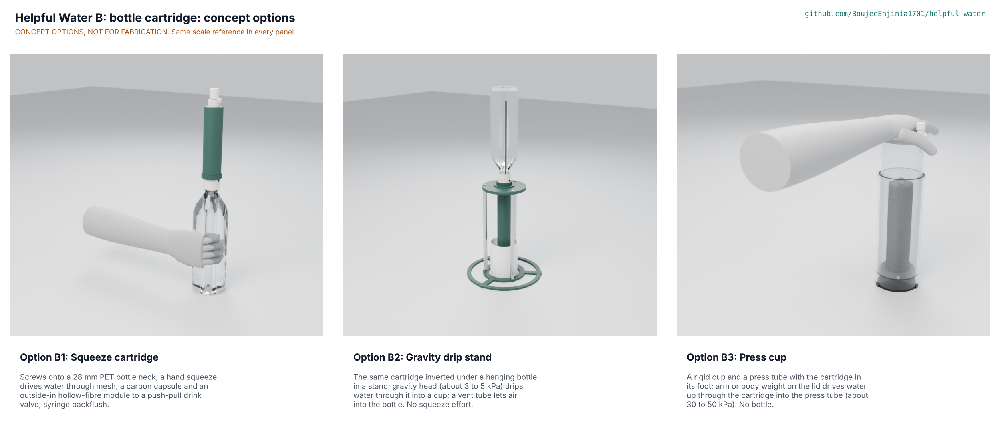

# Helpful Water B: bottle cartridge concept options

Result: B1, the squeeze cartridge, scores 246 of 310 and B2, the gravity drip stand, 222; B2 is 9.8 % below B1, inside the 10 % band, so **both go to Amish without a pick** (Proposed, awaiting Amish; HWB-DEC-001 D1, HWB-DDR-001). B3, the press cup, scores 209 and is not recommended. B1 is carried to the drawings, BOM and build plan because it is the briefed baseline and the B2 cartridge is the same stack turned over with a longer module, so the TRL 3 documents cover most of B2 as well. The best idea of the runner-up, B2's no-squeeze gravity mode, can be grafted onto B1 as an optional stand. All three are modelled at detail level D3 in `cad/src/model.py`. Method: STANDARDS section 21.

The options picture is a Blender Cycles render; the scenes are exported to the render queue (`python .kit/options.py --export`) and wait for Amish's Mac, so `media/options.png` does not exist yet (HWB REVIEW).

## The options

### Option B1: squeeze cartridge

Screws onto a 28 mm PCO 1881 or PCO 1810 PET bottle neck; a hand squeeze drives the water through a 150 um 316L mesh, a replaceable coconut-carbon capsule and a bought, pre-potted hollow-fibre module (outside-in, looped fibres potted at the clean outlet end) to a push-pull drink valve with a hinged dust cover. A duckbill valve in the collar lets air back into the bottle on release. Backflush is with a 60 mL syringe at the nozzle, capsule removed. 24 parts, about 118 g dry, 217 mm long, USD 18.35 of prototype parts. Risks: flow at a weak child's squeeze with a fouled module; squeeze fatigue for litres of household water; a 46 mm width. Needs from a partner: neck survey, persona squeeze trials.

### Option B2: gravity drip stand

The same cartridge stack turned over with a 146.5 mm module (0.295 m2): the filled bottle is screwed onto the collar and hung upside down in a three-leg stand, and gravity (2.5 to 5.2 kPa) drips the water through into a cup. A 4 mm vent tube from a duckbill in the collar reaches into the bottle's air space so the bottle does not lock (HWB-DEC-001 F4); the base is widened to 230 mm so the full stand does not tip (F3). 32 parts, about 6 minutes per litre clean. Risks: slow; a tall stack (568 mm) to knock over; more parts. Needs: household trials, stand material.

### Option B3: press cup

A rigid 76 mm cup and a press tube with the cartridge in its foot: 80 to 150 N of arm or body weight on the lid drives water up through mesh, carbon and fibres into the press tube (18 to 36 kPa). No bottle. 24 parts. Risks: it gives up the pitch of using any PET bottle; the press foot joint is a dirty-to-clean boundary with screws and a push fit (bypass risk); cost; freedom to operate against press-bottle makers is still to search (HWP-FTO-001). A ceramic element was considered as a fourth principle and set aside: a ceramic candle of the size that fits a bottle neck flows far less than hollow fibre at squeeze pressure, weighs more and cracks silently.

## First-order numbers

Table 1. Options compared (estimates, HWB-CAL-001).

| Quantity | B1 squeeze | B2 gravity | B3 press |
| --- | --- | --- | --- |
| Estimated prototype parts cost (USD) | 18.35 (BOM) | About 27 (B1 parts plus stand and longer module, estimate) | About 30 (estimate) |
| Membrane area (m2) | 0.174 | 0.295 | 0.174 |
| Driving pressure (kPa) | 6.2 to 17 held, 43 full grip | 2.5 to 5.2 | 18 to 36 |
| Flow, clean (mL/min) | 160 (weak child) to 465 (adult) | About 160 average | 500 to 990 |
| Effort | Squeeze grip | None | Arm or body weight on a table |
| Mass (g) | About 118 dry | About 450 with the stand | About 500 |
| Parts count | 24 | 32 | 24 |
| Uses any PET bottle | Yes (1881, 1810; 38 mm adapter) | Yes | No |
| STEM check | No Fails; F1, F2 fixed | No Fails; F3, F4 fixed | No Fails |

## Scoring

Table 2. Weighted scoring (weights: High UR 3, Medium 2, Low 1; scores 1 to 5).

| Criterion | Source | Weight | B1 | B2 | B3 | Reason |
| --- | --- | --- | --- | --- | --- | --- |
| Bacteria | UR-001 | 3 | 4 | 4 | 4 | Same membrane in all three |
| Protozoa | UR-002 | 3 | 4 | 4 | 4 | Same membrane |
| Usable flow | UR-004 | 3 | 4 | 3 | 5 | B3 has the most pressure; B2 is slow |
| Ready to use | UR-005 | 3 | 5 | 3 | 4 | B2 needs the stand set up |
| Simple instructions | UR-006 | 3 | 4 | 3 | 4 | Inverting and venting B2 adds steps |
| Low daily upkeep | UR-007 | 3 | 4 | 3 | 4 | B2 has more parts to rinse |
| Know when it fails | UR-008 | 3 | 4 | 3 | 3 | B1's air test is one squeeze; harder on B2 and B3 |
| No bypass | UR-009 | 3 | 4 | 4 | 2 | B3's press foot joint is a second dirty-to-clean boundary |
| Hygienic storage | UR-010 | 3 | 4 | 4 | 3 | B3's large clean reservoir stands wet |
| Safe materials | UR-011 | 3 | 4 | 4 | 4 | Same families |
| Portable | UR-012 | 2 | 4 | 2 | 3 | B2's stand is not portable |
| Affordable | UR-014 | 3 | 4 | 3 | 2 | B2 and B3 add parts |
| Resupply | UR-015 | 2 | 4 | 4 | 4 | Same capsule |
| Shelf life | UR-016 | 2 | 4 | 4 | 4 | Same module |
| Drops and freezing | UR-017 | 2 | 3 | 2 | 3 | B2 is tall and can be knocked over |
| Taste | UR-018 | 2 | 3 | 4 | 3 | B2's slow flow gives the longest carbon contact |
| Cleanable prefilter | UR-019 | 2 | 4 | 4 | 4 | Same mesh |
| Shared use | UR-020 | 2 | 3 | 5 | 4 | B2 fills cups for a household |
| End of life | UR-021 | 1 | 4 | 3 | 3 | Fewer parts in B1 |
| Regional manufacture | UR-022 | 1 | 4 | 4 | 4 | All printable or mouldable |
| Fits my bottle | UR-101 | 3 | 5 | 5 | 1 | B3 uses its own cup |
| No-squeeze option | UR-102 | 2 | 2 | 5 | 4 | B2 needs no effort; B3 uses body weight |
| Cost against the value-engineering target | Target USD 20 | 2 | 5 | 3 | 3 | B1 USD 18.35; B2 and B3 above the target (estimates) |
| Buildable with local skills and tools | BLD | 2 | 4 | 4 | 3 | B3's cup and press need a close-fitting bore |
| Safety | RSK | 3 | 4 | 3 | 3 | B2 tipping; B3 bypass |
| Maintenance | RSK | 1 | 4 | 3 | 3 | Fewest parts in B1 |
| **Weighted total (of 310)** | | | **246** | **222** | **209** | |

## Recommendation

B1 and B2 are within 10 % (9.8 %), so the choice goes to Amish without a pick. The arguments: B1 is cheaper, pocketable, simplest to check and fits the shortlist pitch; B2 removes the squeeze, which matters for elderly and low-dexterity users and for household volumes, and fills cups without a shared mouthpiece. A combined path is worth considering: B1 as the product, with B2's stand as an optional accessory that takes the same cartridge (with the standard module, at about 10 minutes per litre clean) for households. Recorded as Proposed, awaiting Amish (HWB-DEC-001 D1, HWB-DDR-001). B3 is not recommended because it gives up the bottle and adds a bypass route.

## Patent comparison: claim 1 of US 8,852,439 B2 (HWP-FTO-001)

Not legal advice. Claim 1 (as summarised from Google Patents, checked 2026-11-11) is a method of filtering with a drinking-straw device: an inlet, an outlet with a mouthpiece, a conduit holding a single bundle of hydrophilic hollow fibres, a support member sealing the conduit and forming a compartment toward the outlet, liquid drawn through by the drinker's suction into the fibres and out through the membrane walls into the compartment, with the inlet facing down; anticipated expiry 2029-12-18.

Table 3. B options against the elements of claim 1.

| Element of claim 1 | B1 squeeze | B2 gravity | B3 press |
| --- | --- | --- | --- |
| Drinking-straw device with a mouthpiece | Bottle cartridge with a push-pull valve; can be drunk from | No mouthpiece; drips into a cup | Spout on a lid |
| Liquid moved by the drinker's suction | No: moved by squeezing the bottle | No: gravity | No: pressing |
| Liquid enters the fibres (inside) and passes out through the walls | No: outside-in, into the lumens | No: outside-in | No: outside-in |
| Closed fibre ends or loops toward the outlet, open ends at the inlet | No: loops away from the outlet, open ends potted at the clean outlet end | No (same module) | No (same module) |
| Inlet facing down in use | In squeeze use the bottle is tipped, cartridge down: yes | Cartridge below the bottle: inlet up | Inlet down: yes |

Reading: none of the B options uses suction or inside-out flow, which the claim requires. The one use that comes near is a user sucking on the B1 valve like a straw while the bottle hangs down; even then the flow is outside-in with the open ends at the outlet, the reverse of the claimed arrangement. A patent attorney is to confirm this before distribution, and other squeeze-filter patents (for example Sawyer's) are still to search (HWP-FTO-001; HWB-DEC-001 D5).

Licence: this document is licensed under CC-BY-4.0 (Creative Commons Attribution 4.0 International), following the Helpful Engineering licensing guide. Design Molecule Labs with Helpful Engineering.
