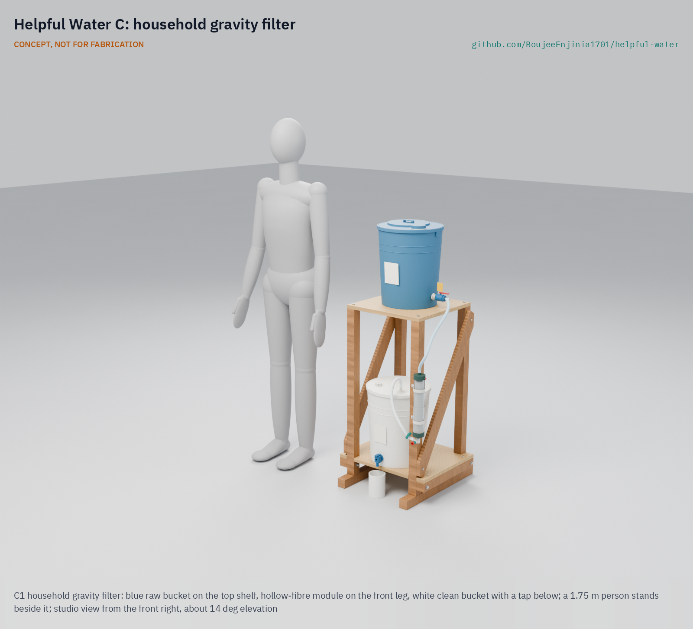
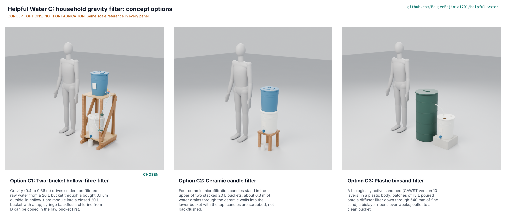
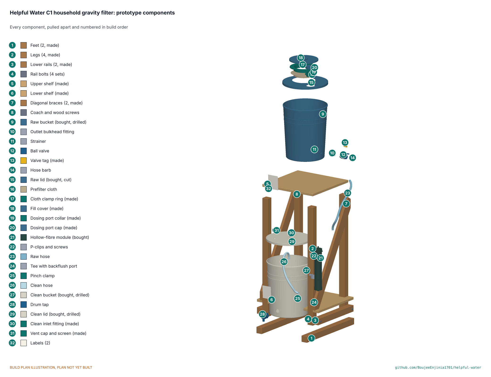

# Helpful Water C: household gravity filter



CONCEPT, NOT FOR FABRICATION. [Studio view](media/render-studio.png) · [Exploded render](media/render-exploded.png) · [Concept render](media/hero.png)

    

**Area:** Food and water security · **TRL:** 3 of 9 (proof of concept on paper) · **Value-engineering target:** USD 60 of prototype parts · **Difficulty:** 2 of 5

A two-bucket household gravity filter on a timber stand, designed to reduce bacteria and protozoa in a day's drinking and cooking water for five people (45 L) in a few hours: a cloth prefilter and a settling zone in the raw bucket, a bought 0.1 um hollow-fibre module, and a closed clean bucket with a tap. It is not a virus barrier, so where viruses are a risk the raw water is dosed with chlorine (solution D) first; the membrane then removes the *Cryptosporidium* that chlorine does not.

> **Release limitation.** Nothing here is a validated water treatment product. No prototype is used to treat water for drinking until its pathogen performance, materials safety, integrity, source suitability and claims are validated by qualified laboratories (HWP-CLM-001).

[Interactive 3D model](media/viewer.html) · [Concept blueprint (PDF)](media/concept-blueprint.pdf) · [General arrangement HWC-DWG-001 (PDF)](cad/drawings/HWC-DWG-001.pdf) · [Section HWC-DWG-002 (PDF)](cad/drawings/HWC-DWG-002.pdf) · [Sizing note HWC-CAL-001](docs/04-calcs/01-sizing.md) · [STEM check](docs/01b-stem-check.md) · [Concept options](docs/02a-concept-options.md) · [Prototype build plan](docs/05-build-plan.md) · [Decisions](docs/06-design-decisions.md) · [Review note](docs/REVIEW.md)

## Concept rationale

A straw serves only the person sipping. A household needs water for cooking, for a stored supply and for small children, and diarrhoeal deaths concentrate in children under five (Ali Raza's review; HWP-PRB-001). Solution C treats the household's water in batches, from buckets families already know, and keeps it in a closed bucket that is only ever emptied through a tap, so storage does not undo the treatment. It is built to work with chlorine rather than against it: dose first, then filter, and the residual protects the stored water.

Design thesis: **two barriers in the right order**: chlorine for viruses and bacteria, a membrane for cysts, and a closed container so nothing comes back in.

## Burning platform

- 2.1 billion people lack safely managed drinking water, and microbiologically contaminated water causes about 505,000 diarrhoeal deaths a year (WHO and UNICEF, 2025; WHO fact sheet; cited in HWP-PRB-001).
- Water from a good source is recontaminated in handling and storage in camps and homes (HWP-SRC-001 SC5).
- Sealed household filters cost about USD 60 to 67 and cannot be built or repaired regionally (HWC-MKT-001).

## Where it could be used

### By industry

| Industry | Use |
| --- | --- |
| Humanitarian response | Household kits for camps and host communities, paired with chlorine |
| Rural water and sanitation programmes | Households with unimproved sources |
| Health and education | Clinic and school water points in batches |
| Local carpentry and plastics | Stands built and small parts printed regionally |

### By country or region

| Country or region | Why it matters there |
| --- | --- |
| Fragile and least developed countries | Safely managed water coverage is 38 points lower in fragile contexts (HWP-PRB-001) |
| Monsoon river basins | Turbid river water (10 to 100 NTU) needs settling before filtration (HWP-SRC-001 SC3) |
| Camps and displacement settings | Distributed water is recontaminated in storage; closed storage with a residual addresses it |

## What sparked the idea

Ali Raza's review of the Helpful Water concept validation questions asked whether a straw is the right unit of intervention at all, since it cannot serve cooking, stored water or an infant, and proposed a household gravity option beside it (HWP-PRB-001). Solution C is that option, worked through the Design Molecule pipeline.

## Problem

Households of about five need 27.5 to 45 L of treated water a day for drinking and cooking (Sphere), kept closed against recontamination, from local containers and without power, including from muddy river water after settling ([HWC-PRB-001](docs/01-problem.md)). Design with, not for: these needs are a desk draft to review with households through a field partner.

## Concept

The carer pours raw water through a folded cotton cloth into a blue 20 L bucket on the top shelf of a timber stand, lets it settle for an hour (longer in the cold), and, where viruses are a risk, doses it with solution D through a port in the lid and waits 30 minutes. Opening the valve lets the water fall from a strainer outlet 50 mm above the bucket floor, through a clear silicone hose, into the top of an upright, bought, pre-potted 0.1 um hollow-fibre module (600 looped fibres, 0.66 m2) beside the front leg. Filtered water leaves the bottom of the module through a tee with a luer backflush port and rises into a closed white 20 L bucket with a tap ([HWC-PRC-001](docs/02-concept.md)).

## Concept options

Three working principles were modelled at detail level D3 and scored ([HWC-OPT-001](docs/02a-concept-options.md)): **C1 two-bucket hollow-fibre filter (286 of 345)**, C2 ceramic candle filter (234) and C3 plastic biosand filter (227). C1 leads by 22 % and was chosen by Amish on 2026-11-11 (HWC-DEC-001 D1). None of the options falls within claim 1 of US 8,852,439 B2, which covers a suction straw (HWC-OPT-001; not legal advice). The options picture (`media/options.png`) is rendered in Blender.



## STEM check

No claim fails; 25 of 36 sit within known science and 11 stay open for supplier data and TRL 4 tests ([HWC-STM-001](docs/01b-stem-check.md)). Five details failed and were fixed under Amish's standing instruction: wider feet for the stand, an upright module with a bleed screw, a low refill line so a batch never overflows, a dosing port and a 30 minute valve tag for chlorine contact, and a check valve so the air test reaches its pressure. An independent reviewer agent attacked every "within" verdict; its findings and the changes are recorded. Estimates (HWC-CAL-001), at an **assumed** membrane permeability that the module maker must confirm:

| Quantity | Value |
| --- | --- |
| Gravity head | 0.42 to 0.66 m (4.1 to 6.4 kPa) |
| Flow | 30 L/h clean, 16 L/h when a backflush is due |
| 45 L day (five people) | 1.6 h of filtering clean, 2.8 h fouled; about 6 to 8 h elapsed with settling and contact |
| Pressure taken by everything but the membrane | 0.7 kPa at the mean head |
| Flow at persona efforts | Gravity does the work for every user; a cup from the tap in about 9 s; a gentle 30 N syringe push to backflush |
| Air test | Shows any opening above about 3 um at 100 kPa; not a proof of performance |
| Stability | 18.7 deg tip angle loaded; wall strap proposed |
| Size and mass | 520 x 560 x 1,300 mm; 15 kg empty, about 49 kg full |
| Prototype parts | USD 86.40 (USD 26.40 over the USD 60 target) |
| Cost over life | USD 0.003 a litre; USD 9.44 per person per year (module life assumed) |

## Key components

Two new food-grade 20 L HDPE buckets with lids (blue raw, white clean); a bought pre-potted 0.1 um hollow-fibre module; a polypropylene bulkhead, 250 um stainless strainer, ball valve, tee with a luer check valve and cap, pinch clamp and drum tap; clear silicone hose; seven printed polypropylene parts (cloth clamp ring, fill cover, dosing collar and cap, clean inlet fitting, vent cap, valve tag); a timber and plywood stand with coach screws, bolt sets and wood screws; a 60 mL syringe ([bom/bom.csv](bom/bom.csv), 32 lines).

## Building the prototype

The [prototype build plan](docs/05-build-plan.md) (HWC-BLD-001) shows how to saw and bolt the stand, print the seven small parts, drill the buckets and lids, fit the bought module and fittings without glue or potting, and assemble the filter in twelve steps, with a picture for every part and step and first checks with known potable test water only. It is a plan, not yet built.



## Safety

Treat every prototype as unproven and test it only with known potable test water. A full raw bucket weighs about 18 kg on a shelf 0.9 m up: fill it in place, keep the stand on a level floor and strap it to a wall where children play. Use only new food-grade buckets and keep the blue raw and white clean parts apart. Backflush only with water from the clean tap and a gentle push. Do not let it freeze wet; retire the module after any freezing or a failed air test. Never rely on it for flood or runoff, salt or chemically contaminated water. It does not remove viruses unless chlorine is added first, or dissolved chemicals at all. This is a TRL 3 concept, not released for fabrication.

## Claims and limits

From [HWP-CLM-001](../../docs/12-claims.md):

- **May say now:** "Designed to reduce bacteria and protozoa in household water for drinking and cooking."
- **Only after accredited, independent testing:** log reductions by class against the WHO household treatment scheme, at the stated flow and life.
- **Never say:** "purifies", "sterilises", "virus-proof", "makes any water safe", "removes all contaminants"; no claim that it serves infants unless tested at the infant-use volume and paired with D where viruses are a risk.
- **On-product warning:** "Reduces bacteria and protozoa. Does not remove viruses. Where viral disease is a risk, also treat the water with chlorine (solution D or a WHO-recommended tablet)," with the crossed-out virus and tablet pictogram, on the raw bucket label.
- **Exclusions:** viruses, salt, arsenic, nitrate, fluoride, lead, PFAS, pesticides, fuel and industrial chemicals; do not freeze when wet.
- **Release limitation:** no prototype is used to treat water for drinking until pathogen performance, materials safety, integrity, source suitability and claims are validated by qualified laboratories.

## Helpful Engineering

Solution C is one of four lettered solutions in Helpful Water, a joint program of Design Molecule Labs and Helpful Engineering's Infectious Disease Challenge. It shares the program problem, source classes, user requirements, claims, regulatory, market, verification and patent documents in [`docs/`](../../docs/) and is described in the [program README](../../README.md). Solution D, the chlorine add-on, is the co-treatment C pairs with: it doses the raw bucket through C's lid port, and C's membrane then removes the cysts chlorine leaves.

## Repository layout

```
docs/                       controlled documents (PRB, STM, OPT, PRC, URS, PRS, RTM, CAL, BLD, DEC, REG, FEA, RSK, MKT, PLN) and REVIEW.md
docs/04-calcs/              sizing.py (HWC-CAL-001), stem_check.py, stm_table.py, results
docs/decisions/             decision records (concept selection, design for construction, STEM fixes)
docs/05-build-plan/         build plan pictures
cad/src/params.py           every main dimension, shared by the model and the calculations
cad/src/model.py            parametric model, options C1 to C3 at detail level D3 (kit 1.9)
cad/src/c_parts.py          buckets, lids, bulkhead, valve, barbs, hoses, tee, tap, module, candles, timber
cad/src/sheets.py           drawings HWC-DWG-001 and 002, STL export
cad/src/build_plan_media.py build plan pictures and making sketches HWC-DWG-101 to 113
cad/src/concept_media.py    hero, cutaway, exploded, flow, 3D viewer, concept blueprint
cad/src/product_model.py    appearance model and render views (Blender)
cad/step/, cad/stl/, cad/drawings/   exports
bom/bom.csv                 priced bill of materials (C1)
.kit/                       shared documentation kit 1.9.1-he (do not edit here)
```

## Documentation

Controlled documents follow the portfolio standards in [.kit/STANDARDS.md](.kit/STANDARDS.md), including the Helpful Engineering profile (section 25). From this folder run `python .kit/render.py --check`, `python .kit/cad_check.py --export`, `python docs/04-calcs/sizing.py`, `python docs/04-calcs/stem_check.py`, `python docs/04-calcs/stm_table.py` and `python .kit/trace.py`.

## Credits

Amish Chadha, Ali Raza, Suraksha Bhat, Lillian Fernandes, Raksha Thammaiah and James Butler (Design Molecule Labs with Helpful Engineering). AI assistance (Claude) was used to accelerate research, calculations, CAD and documentation; design direction and all decisions are Amish Chadha's, recorded in [docs/06-design-decisions.md](docs/06-design-decisions.md).

## Licenses

Following the [Helpful Engineering licensing guide](https://helpfulengineering.org/licensing-guide/):

- Hardware (CAD sources, STEP, drawings, BOM, build plan pictures): CERN-OHL-P-2.0, [`../../LICENSE-HARDWARE.txt`](../../LICENSE-HARDWARE.txt)
- Software (calculation and kit scripts, web viewer): Apache-2.0, [`../../LICENSE-SOFTWARE.txt`](../../LICENSE-SOFTWARE.txt)
- Documentation (controlled documents, README, renders): CC-BY-4.0, [`../../LICENSE-DOCUMENTATION.txt`](../../LICENSE-DOCUMENTATION.txt)

---

Design Molecule Labs with Helpful Engineering
