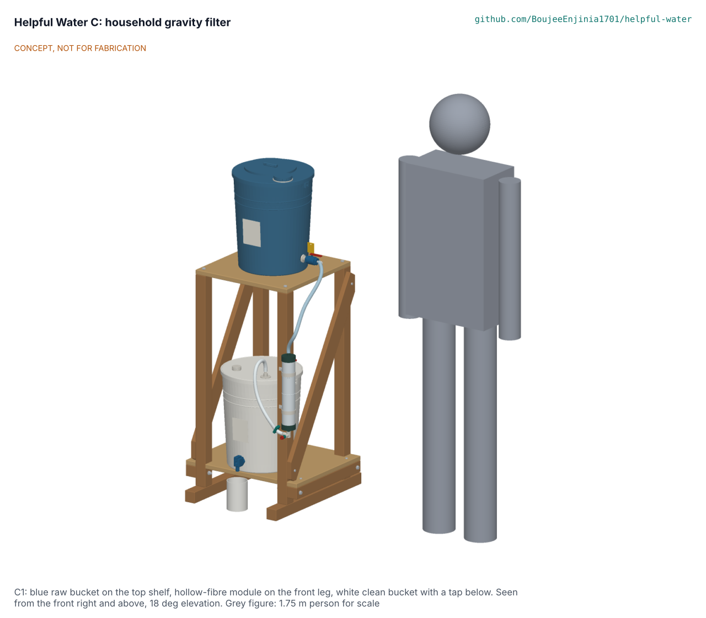

# Helpful Water C: household gravity filter design precis

C1 is a two-bucket gravity filter on a timber stand that is designed to reduce bacteria and protozoa in a household's drinking and cooking water: about 45 L a day for five people in 1.6 to 2.8 hours of filtering, kept in a closed bucket with a tap. It does not remove viruses; where viral disease is a risk the raw water is dosed with chlorine (solution D) first, and the membrane then removes the *Cryptosporidium* that chlorine does not inactivate. The concept choice was made by Amish on 2026-11-11 (HWC-DEC-001 D1); this precis describes C1 because it is carried to the drawings, BOM and build plan.

> **Release limitation.** Nothing here is a validated water treatment product. No prototype is used to treat water for drinking until its pathogen performance, materials safety, integrity, source suitability and claims are validated by qualified laboratories (HWP-CLM-001).

## How it works

1. **Fill and prefilter.** The carer pours raw water from 5 L jugs through a cotton cloth (folded to eight layers, about 20 um) held in the raw lid's fill ring, up to the 17 L line. The raw valve is shut.
2. **Settle.** The water stands for at least an hour, an hour and a half below 10 degC, and overnight above about 50 NTU. Silt of 10 um and larger settles below the outlet, which sits 50 mm above the floor behind a 250 um stainless strainer.
3. **Dose (where viruses are a risk).** A solution D dose goes in through the 60 mm port in the raw lid; the valve tag says "shut 30 minutes after dosing".
4. **Filter.** At the first fill the bleed screw on the module's top cap is opened until water shows. Opening the valve lets water fall through a silicone hose to the top of an upright, bought, pre-potted hollow-fibre module (600 looped fibres, 0.1 um, 0.66 m2) on the front leg of the stand. Water passes the fibre walls from outside in and leaves through the potted header at the bottom, through a tee and a clean hose that rises into the inlet fitting in the clean bucket's lid. A batch of 14 L takes about 28 minutes with a clean module.
5. **Store and draw.** The white clean bucket is closed by its lid, with a screened vent; water is drawn only through the tap, 45 mm above the floor. Any chlorine residual from D passes the membrane and protects the stored water.
6. **Backflush.** When a batch slows, the user shuts the pinch clamp on the clean hose, fills the 60 mL syringe from the tap and pushes it gently into the luer check valve on the tee three times, raw valve open; the water goes back up the raw hose into the raw bucket.
7. **Check.** Monthly, and after any hard knock, the user pumps air strokes from the syringe through the check valve, pinch clamp shut, until a firm push of about 5 kg holds: bubbles streaming up the clear raw hose mean a broken fibre, and the module is retired. After any freezing the module is retired without testing.

## Key figures (estimates, HWC-CAL-001)

Table 1. Key figures.

| Quantity | Value |
| --- | --- |
| Footprint and height | 520 x 560 mm, 1.30 m to the top of the raw lid |
| Containers | Two 20 L food-grade HDPE buckets; 17 L fill line, 14.4 L batch, 2.5 L refill line |
| Head | 0.42 to 0.66 m (4.1 to 6.4 kPa) |
| Flow | 30 L/h clean, 16 L/h when a backflush is due (assumed permeability) |
| Daily filtering | 1.6 h clean, 2.8 h fouled for 45 L |
| Stability | 18.7 deg tip angle loaded; 78 N at 1 m |
| Mass | 15 kg empty; about 49 kg full |
| Prototype parts | USD 86.40 (USD 26.40 over the USD 60 value-engineering target) |
| Cost over life | USD 0.003 a litre; USD 9.44 per person per year (module life assumed) |

## What it does not do

It does not remove viruses unless chlorine is added first, and it does not remove dissolved chemicals: arsenic, fluoride, nitrate, lead, PFAS, pesticides, cyanotoxins, salt, fuel, industrial chemicals or radiological contaminants. It is not for flood or runoff water as a sole barrier (SC6) or for brackish, sea or mining water (SC7). No claim is made that it serves infants until it is tested at the infant-use volume and paired with D (HWP-CLM-001).

## Safety

> **Safety:** Treat every prototype as unproven and run it only with known potable test water. A full raw bucket weighs about 18 kg on a shelf 0.9 m up: fill it in place, never lift it full, keep the stand on a level floor, and tie it to a wall where children play. Use only new food-grade buckets, never pails that held chemicals, and keep the raw (blue) and clean (white) parts apart; the cloth, syringe and hands must not go into the clean bucket. Backflush only with water from the clean tap and a gentle push. Do not let it freeze wet; retire the module after any freezing, and after a hard knock that is followed by a stream of bubbles in the air test. Chlorine from solution D is handled as D's instructions say. Settle turbid water first, longer in cold weather.

## Where the design came from

The options and their scores are in HWC-OPT-001; the STEM check in HWC-STM-001; the requirements in HWC-URS-001 and HWC-PRS-001; the decisions in HWC-DEC-001.

Licence: this document is licensed under CC-BY-4.0 (Creative Commons Attribution 4.0 International), following the Helpful Engineering licensing guide. Design Molecule Labs with Helpful Engineering.
