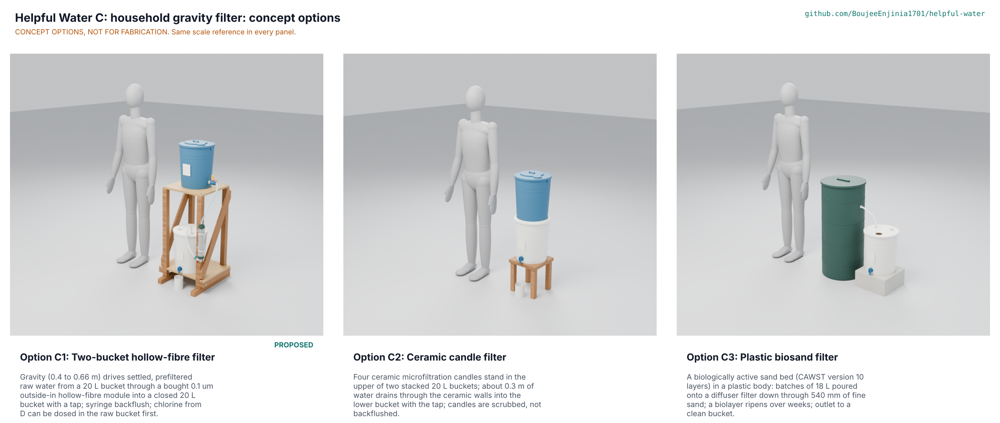

# Helpful Water C: household gravity filter concept options

Recommendation: **C1, the two-bucket hollow-fibre filter (286 of 345)**, ahead of C2 ceramic candles (234) by 22 % and C3 biosand (227); the choice is **Proposed, awaiting Amish** (HWC-DEC-001 D1, HWC-DDR-001). C1 is the only option that treats the 45 L day in a few hours, needs no ripening, removes *Cryptosporidium* after a chlorine dose and leaves the chlorine residual in the stored water. Its best graft from the runners-up is C3's discipline of dosing chlorine where it protects storage, and C2's tool-free stacking where no stand can be built. Method: STANDARDS section 21. Every option is modelled at detail level D3 in `cad/src/model.py`; the options picture (`media/options.png`) is rendered with Blender Cycles on Amish's Mac from the scenes in the render queue, so it is not yet in this folder.

> **Release limitation.** No prototype is used to treat water for drinking until its pathogen performance, materials safety, integrity, source suitability and claims are validated by qualified laboratories (HWP-CLM-001).

## The options

### Option C1: two-bucket hollow-fibre filter

Gravity drives settled, prefiltered raw water from a blue 20 L bucket on the top shelf of a timber stand through a bought, pre-potted 0.1 um outside-in hollow-fibre module into a closed white 20 L bucket with a tap on the lower shelf. The raw lid carries a cotton cloth prefilter and a dosing port for solution D; the raw outlet sits 50 mm above the floor behind a strainer, so sediment settles below it. The module stands upright on the front leg with its inlet on top; a tee below it carries a luer backflush port. First-order numbers: head 0.42 to 0.66 m, 30 L/h clean, 45 L a day in 1.6 to 2.8 h, USD 85.60 of prototype parts, 84 modelled parts. Key risks: the assumed permeability, the fill height (1.27 m rim) and the module's backwash limit. From a co-design partner: local bucket sizes, how households fill, acceptable chlorine taste.

### Option C2: ceramic candle filter

Four ceramic microfiltration candles stand in the upper of two stacked 20 L buckets on a stool; about 0.3 m of water drains through the ceramic walls into the lower bucket, which has the tap. Candles are scrubbed when slow, not backflushed. First-order numbers: about 4 L/h full, 45 L in about 19 h, about USD 115 of parts (four candles at about USD 22 each), 29 modelled parts. Key risks: slow flow, cracks that do not show, silver biocide registration (HWP-REG-001 W9) and silver leaching. From a co-design partner: whether overnight filtering suits the household day.

### Option C3: plastic biosand filter

A 900 mm HDPE body holds 50 mm of drainage gravel, 50 mm of separating gravel and 540 mm of fine sand under a perforated diffuser. Batches of 18 L poured on top drain through the sand; an outlet tube sets a 50 mm standing water layer that keeps the biological layer alive, and a hose leads to a closed clean bucket. First-order numbers: up to 0.4 L/min, 2.5 batches a day with pauses, 124 kg of media, about USD 100 of parts (the CAWST plastic body is about USD 75), 26 modelled parts. Key risks: up to 30 days of ripening with low and silent removal, 1 to 2 log bacteria in field data, sand washing and grading by the user. From a co-design partner: local sand and a trained installer.

## First-order numbers

Table 1. Options compared (estimates; HWC-CAL-001 sections 4 and 8; HWC-STM-001).

| Quantity | C1 hollow fibre | C2 ceramic candles | C3 biosand |
| --- | --- | --- | --- |
| Estimated parts cost (USD) | 85.60 (BOM) | About 115 | About 100 |
| Mass empty, model (kg) | 15.3 | 3.8 | 135 with media |
| Throughput | 30 L/h clean, 16 L/h fouled | About 4 L/h full | Up to 24 L/h, batches with pauses |
| Time for the 45 L day | 1.6 to 2.8 h | About 19 h | 2.5 batches spread over the day |
| Effort | Pour 5 L jugs to a 1.27 m rim; tap; syringe | Pour to a 1.06 m rim; tap; scrub | Pour to a 0.9 m rim; tap |
| Ready to use | Same day | Same day (soak candles) | Up to 30 days to ripen |
| Pathogen principle | 0.1 um size exclusion | Ceramic microfiltration, optional silver | Biological layer and straining |
| Chlorine (D) position | Raw bucket, before the membrane | Upper bucket or clean bucket | Clean bucket only, never upstream |
| Parts in the model | 84 | 29 | 26 |
| STEM check | Within; 4 details fixed | Within; slow | Within; lower bacteria reduction |

## Scoring

Table 2. Weighted scoring (weights: High UR 3, Medium 2, Low 1; scores 1 to 5; WHO household treatment star levels of HWP-CLM-001 Table 2 used as targets, never as passes).

| Criterion | Source | Weight | C1 | C2 | C3 | Reason |
| --- | --- | --- | --- | --- | --- | --- |
| Bacteria | UR-001 | 3 | 5 | 4 | 2 | 0.1 um modules of this class test above 7 log in the laboratory; candles list 4 log; biosand 1 to 2 log in field data (below the WHO two-star 2 log in part) |
| Protozoa | UR-002 | 3 | 5 | 4 | 4 | Size exclusion with a large margin; ceramic similar; biosand above 99.9 % in the laboratory |
| Viruses addressed with D | UR-003 | 3 | 5 | 4 | 4 | C1 doses before the membrane and keeps the residual; C2 and C3 dose in storage |
| Usable flow without effort | UR-004 | 3 | 5 | 2 | 3 | Gravity in all three; C2 is too slow for daytime use |
| Ready to use | UR-005 | 3 | 4 | 4 | 1 | Biosand needs weeks to ripen |
| Simple instructions | UR-006 | 3 | 4 | 4 | 3 | Biosand pause and do-not-disturb rules |
| Low daily upkeep | UR-007 | 3 | 4 | 3 | 3 | Syringe backflush under 2 min; candle scrubbing; biosand swirl-and-dump |
| Know when it fails | UR-008 | 3 | 3 | 2 | 1 | C1 air hold test; cracked candles and an unripe sand bed fail silently |
| No bypass in service | UR-009 | 3 | 4 | 3 | 3 | C1 clean side is above atmospheric; candle changes open the clean chamber |
| Hygienic storage | UR-010 | 3 | 4 | 4 | 3 | Closed clean buckets; biosand must stay wet |
| Safe materials | UR-011 | 3 | 4 | 3 | 4 | Silver in C2 |
| Household volume | UR-013 | 3 | 5 | 3 | 4 | 45 L meets in all three, in very different times |
| Affordable | UR-014 | 3 | 4 | 3 | 4 | About USD 0.003 a litre for C1; candles replaced yearly |
| Resupply | UR-015 | 2 | 5 | 3 | 5 | No consumable in C1 and C3 for about two years |
| Shelf life and transit | UR-016 | 2 | 4 | 4 | 3 | Biosand media is heavy to ship or must be sourced locally |
| Knocks and freezing | UR-017 | 2 | 3 | 2 | 3 | Ceramic is brittle |
| Taste | UR-018 | 2 | 3 | 3 | 3 | Chlorine taste with D in all three; no carbon |
| Cleanable prefilter | UR-019 | 2 | 5 | 5 | 4 | Cloth ring in C1 and C2 |
| End of life | UR-021 | 1 | 3 | 3 | 4 | Plastic module and candles; sand returns to the ground |
| Regional manufacture | UR-022 | 1 | 4 | 3 | 5 | Module imported; candles imported |
| Safe storage | UR-101 | 3 | 5 | 4 | 4 | C1 closed lid with inlet and screened vent |
| Turbid water | UR-102 | 2 | 4 | 3 | 3 | Settling zone and backflush; candles clog; biosand needs under 50 NTU |
| No lifting full containers | UR-103 | 2 | 3 | 3 | 4 | Filled in place in all three; C1 rim highest |
| Stability | UR-104 | 3 | 4 | 4 | 5 | C1 tips at 18.7 deg after the feet fix; C3 is low and heavy |
| Cost against the value-engineering target | Kit | 2 | 3 | 2 | 3 | All over USD 60 |
| Buildable with local skills | Kit | 2 | 4 | 5 | 3 | C3 needs graded, washed sand |
| Safety | Kit | 3 | 4 | 4 | 3 | Silent failure modes weigh against C3 |
| Maintenance | Kit | 1 | 4 | 3 | 3 | |
| **Weighted total (of 345)** | | | **286** | **234** | **227** | C1 leads by 22 % |

## Comparison with claim 1 of US 8,852,439 B2

Claim 1 of US 8,852,439 B2 (HWP-FTO-001) covers drinking through a straw that holds one bundle of hydrophilic hollow fibres potted with one open and one closed end (or looped), water entering the open ends from the inlet side and passing outward through the walls, with the closed ends toward the outlet and the user drawing by mouth suction. C1 is not a straw and has no mouth suction: a gravity head drives raw water onto the outside of looped fibres in a bought module, and permeate leaves through the open lumen ends in the potted header (outside-in, the reverse flow direction). C2 and C3 use no hollow fibres. On this desk reading none of the options falls within claim 1; the module maker's own patents and other gravity-filter patents are still to search (HWP-FTO-001 row 2). This is not legal advice; a patent attorney confirms before any distribution.

## Recommendation

C1 is recommended: it is the only option that meets the household day in a few hours from the first day, pairs with D in the order that covers both viruses and *Cryptosporidium*, and keeps the stored water closed with a residual. Grafts from the runners-up: from C2, a stacked arrangement (raw bucket on the clean bucket's lid with the module between) as a fallback where no stand can be built, at the cost of head; from C3, the CAWST practice of dosing chlorine in storage during any period when the filter's performance is in doubt. Recorded as "Proposed, awaiting Amish" in HWC-DEC-001 (D1) and argued in HWC-DDR-001.

Licence: this document is licensed under CC-BY-4.0 (Creative Commons Attribution 4.0 International), following the Helpful Engineering licensing guide. Design Molecule Labs with Helpful Engineering.
