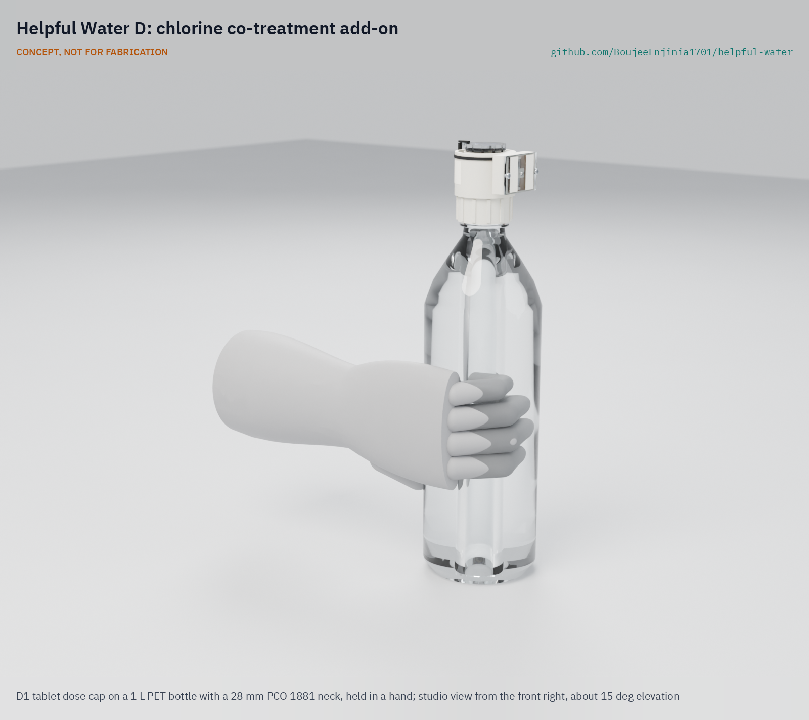
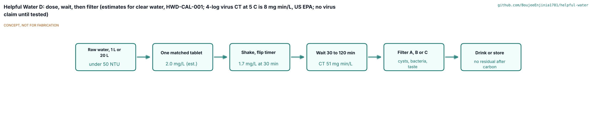
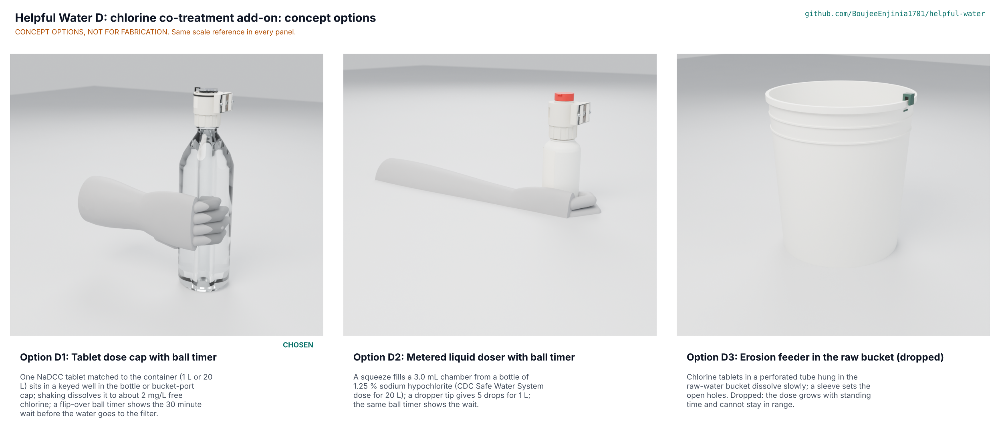
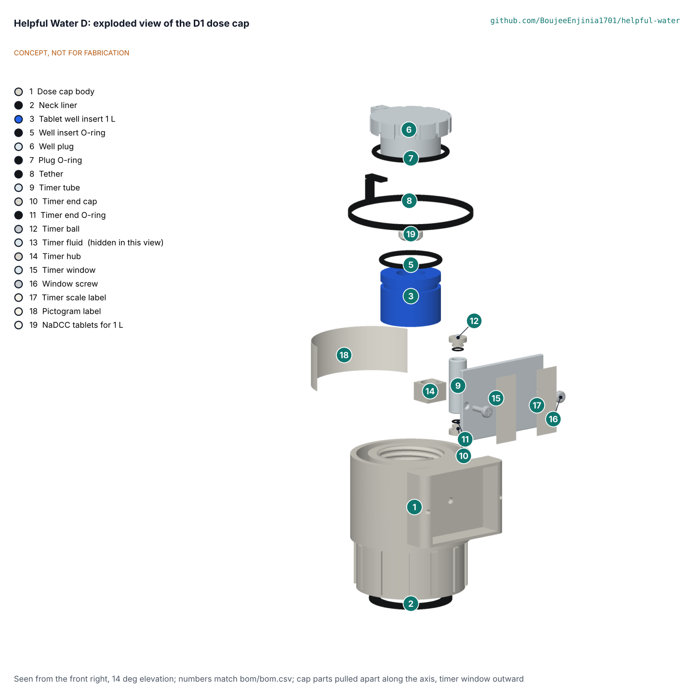
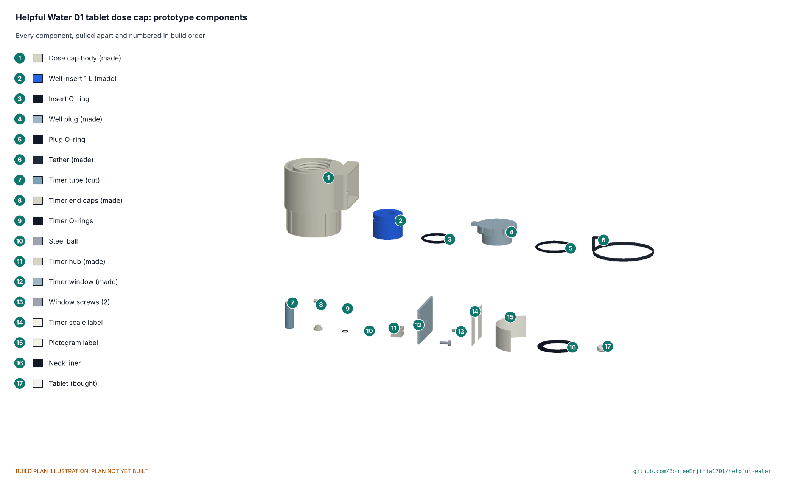

# Helpful Water D: chlorine co-treatment add-on



CONCEPT, NOT FOR FABRICATION. [Studio view](media/render-studio.png) · [Exploded render](media/render-exploded.png) · [Concept render](media/hero.png)

    

**Area:** Food and water security · **TRL:** 3 of 9 (proof of concept on paper) · **Value-engineering target:** USD 10 of prototype parts · **Difficulty:** 1 of 5

A tool-free dose cap that holds one chlorine tablet matched to the container and shows the 30 minute wait with a flip-over ball timer, so raw water is chlorinated at the household rate before it goes through a Helpful Water filter (A, B or C). It is the co-treatment that addresses viruses, which the filters do not remove; the filters remain the barrier for *Cryptosporidium*, which chlorine does not inactivate.

> **Release limitation.** Nothing here is a validated water treatment product. No prototype is used to treat water for drinking until its pathogen performance, materials safety, integrity, source suitability and claims are validated by qualified laboratories (HWP-CLM-001).

[Problem](docs/01-problem.md) · [STEM check](docs/01b-stem-check.md) · [Concept options](docs/02a-concept-options.md) · [Precis](docs/02-concept.md) · [Requirements](docs/03-requirements.md) · [Calculations](docs/04-calcs/01-sizing.md) · [Prototype build plan](docs/05-build-plan.md) · [Decisions](docs/06-design-decisions.md) · [Review](docs/REVIEW.md) · [3D viewer](media/viewer.html)

## Concept rationale

Chlorine is already in every humanitarian supply chain and inactivates viruses at a few milligrams per litre in half an hour, but it is used wrongly in practice: the wrong tablet for the container, a short wait, no extra time in cold water, and drinking before filtering. A cap that only accepts the right tablet, shows that it has dissolved and shows when the wait is over fixes those errors with standard tablets and no tools.

## Burning platform

The Helpful Water filters reduce bacteria and protozoa but not viruses (HWP-CLM-001), while hepatitis A, norovirus and rotavirus are common where water is faecally contaminated. A household that relies on a filter alone where viral disease circulates is exposed; a household that relies on chlorine alone is exposed to *Cryptosporidium*. Together they cover each other.

## Where it could be used

### By industry

- Humanitarian WASH response: relief kits that already carry NaDCC tablets and a filter.
- Household water treatment programmes run by NGOs and ministries of health.
- Schools and clinics using C-type household filters for drinking water.
- Field teams and travellers using A or B.

### By country or region

- Wherever the WASH cluster distributes household chlorine tablets in emergencies.
- Regions with known viral waterborne disease, and high-HIV-prevalence regions where immunocompromised users need a higher margin (HWP-PRB-001).
- Highland and winter settings, where the cold-water run count matters.
- Not for flood or urban runoff, very muddy water or chemically contaminated sources (HWP-SRC-001 SC6, SC7).

## What sparked the idea

Amish's decision of 2026-11-11, "No virus claim, co-treat", and the concept validation questions, which recommend pairing filters with WHO-approved chlorine tablets and putting a "virus crossed out, tablet beside it" pictogram on the product.

## Problem

Viruses pass the filters; chlorine tablets address them but are under-dosed, mis-sized, not given long enough and used in the wrong order. See [HWD-PRB-001](docs/01-problem.md), which cites the program problem HWP-PRB-001.

## Concept

Fill the bottle (1 to 1.5 L) or bucket, drop one tablet from its strip into the keyed well (blue 1 L, orange 20 L) and screw on the cap; turn a bottle over and shake until the tablet is gone (on the bucket, pour raw water through the well until it is gone and stir for 30 seconds); stand it up and flip the timer: one run above 18 C, two at 10 to 18 C, three below 10 C. Then filter with A, B or C. See [HWD-PRC-001](docs/02-concept.md).



Figure 2. Dose, wait, then filter (estimates, HWD-CAL-001).

## Concept options

Three working principles were modelled to detail level D3 and scored (HWD-OPT-001): **D1 tablet dose cap** 174 of 215 (**chosen by Amish on 2026-11-11**), **D2 metered liquid doser** for 1.25 % hypochlorite 143, and **D3 erosion feeder** in the bucket 85, dropped because its dose grows with standing time.



## STEM check

`stem_check: open`. Clear water dosed at 2 mg/L keeps an estimated 1.7 mg/L after 30 minutes, a CT of about 51 mg min/L (US EPA definition) against 8 for 4-log virus inactivation at 5 C (US EPA); no virus credit is taken above 5 NTU. Five details failed as briefed and were fixed under Amish's standing instruction (turbid rule, keyed wells, two-tablet stop, cold-water run count, an O-ring groove), plus a timer margin. An independent reviewer, run as a separate process on 2026-11-11, found 20 rows that hold, 18 weak and 5 refuted of 43; six more fixes followed (a pour-and-stir method for the 20 L bucket, a 1 to 1.5 L bottle range, a 2.0 mm D2 dropper orifice, O-ring tolerances, a 45 minute timer that reads at least 30 minutes up to 40 C, and no polycarbonate in the well). Two findings were settled by Amish on 2026-11-11: C stays carbon-free so its stored water keeps a residual while A and B claim none (S16), and each household kit carries free chlorine test strips (S43). See [HWD-STM-001](docs/01b-stem-check.md).

## Key components

Cap body with a 28 mm PCO 1881 thread and timer boss; silicone neck liner; keyed tablet well inserts; clear well plug with a stop spigot; tether; ball timer (clear tube, 2 mm steel ball, silicone fluid, hub with trunnions) behind a clear window; labels; standard household NaDCC tablets (3.5 mg per 1 L, 67 mg per 20 L). Priced in [bom/bom.csv](bom/bom.csv): USD 9.15 of parts and test tablets against the USD 10 target.



Figure 3. Exploded view; numbers match the BOM.

## Building the prototype

The [prototype build plan](docs/05-build-plan.md) (HWD-BLD-001, plan, not yet built) shows how to print the seven made parts, cut the timer tube and window, fill and seal the timer capsule and assemble the cap in eight steps, then check the seals, the tablet key, the two-tablet limit, the timer and the dose with known potable test water only. Chlorinated test water is poured away; nobody drinks from a prototype.



Figure 4. Prototype components in build order.

## Safety

> **Safety:** Chlorine tablets are a chemical: keep strips from children, never swallow a tablet, never use more than two in a container or a 20 L tablet in a bottle, and never mix chlorine products or use pool tablets. Always wait the full time and filter after: chlorine does not inactivate *Cryptosporidium*. Hazard analysis and design FMEA: [HWD-RSK-001](docs/09-risk.md).

## Claims and limits

From HWP-CLM-001:

- **May say now:** "Doses chlorine at the WHO-recommended household rate to address viruses and bacteria when used with a filter."
- **Only after accredited, independent testing:** a measured free chlorine residual and contact time at stated pH, temperature and turbidity; a virus log reduction for the combined system.
- **Never say:** "kills everything", "makes water safe", or any claim against *Cryptosporidium* from chlorine alone.
- **Exclusions shown on the product:** chlorine does not inactivate *Cryptosporidium*; wait the full contact time; use a filter for cysts. Dissolved chemicals, salt, arsenic, nitrate, fluoride, lead, PFAS, pesticides and unknown industrial contaminants are not addressed, and D is not for water above about 50 NTU.
- **On-product virus warning (carried by A to C):** "Reduces bacteria and protozoa. Does not remove viruses. Where viral disease is a risk, also treat the water with chlorine (solution D or a WHO-recommended tablet)." D is that co-treatment.
- **Release limitation:** no prototype is used to treat water for drinking until its pathogen performance, materials safety, integrity, source suitability and claims are validated by qualified laboratories.

## Helpful Engineering

Helpful Water is a joint program of Design Molecule Labs and Helpful Engineering: one repository with four lettered solutions (A straw, B bottle cartridge, C household gravity filter, D this chlorine add-on) sharing a problem statement, user requirements, claims register and verification plan. See the [program README](../../README.md).

## Repository layout

```
docs/                       controlled documents (PRB, STM, OPT, PRC, URS, PRS, RTM, CAL, BLD, DEC, REG, FEA, RSK, MKT, PLN) and REVIEW.md
docs/04-calcs/              sizing.py (HWD-CAL-001), stem_check.py, stm_table.py, results
docs/decisions/             decision records (concept selection, design for construction, STEM fixes)
docs/05-build-plan/         build plan pictures
cad/src/model.py            parametric model, options D1 to D3 at detail level D3 (kit 1.9)
cad/src/hw_parts.py         threads, O-rings, gaskets, tablets, PET bottle, small bottle, 20 L bucket, small screws
cad/src/sheets.py           drawings HWD-DWG-001 and 002, STL export
cad/src/build_plan_media.py build plan pictures and making sketches HWD-DWG-101 to 107
cad/src/concept_media.py    hero, cutaway, exploded, flow, 3D viewer, concept blueprint
cad/src/product_model.py    appearance model and render views (Blender)
cad/step/, cad/stl/, cad/drawings/   exports
bom/bom.csv                 priced bill of materials (D1)
.kit/                       shared documentation kit 1.9.1-he (do not edit here)
```

## Documentation

All controlled documents carry the HWD prefix and are licensed CC-BY-4.0; the traceability matrix [HWD-RTM-001](docs/03b-traceability.md) is generated by `python .kit/trace.py`. Shared documents are cited by doc_id: HWP-PRB-001, HWP-SRC-001, HWP-URS-001, HWP-CLM-001, HWP-REG-001, HWP-MKT-001, HWP-PLN-001, HWP-VER-001, HWP-FTO-001.

## Credits

Amish Chadha, Ali Raza, Suraksha Bhat, Lillian Fernandes, Raksha Thammaiah and James Butler (Design Molecule Labs with Helpful Engineering). AI assistance (Claude) was used to accelerate research, calculations, CAD and documentation; design direction and all decisions are Amish Chadha's, recorded in [docs/06-design-decisions.md](docs/06-design-decisions.md).

## Licenses

Following the [Helpful Engineering licensing guide](https://helpfulengineering.org/licensing-guide/):

- Hardware (CAD sources, STEP, drawings, BOM, build plan pictures): CERN-OHL-P-2.0, [`../../LICENSE-HARDWARE.txt`](../../LICENSE-HARDWARE.txt)
- Software (calculation and kit scripts, web viewer): Apache-2.0, [`../../LICENSE-SOFTWARE.txt`](../../LICENSE-SOFTWARE.txt)
- Documentation (controlled documents, README, renders): CC-BY-4.0, [`../../LICENSE-DOCUMENTATION.txt`](../../LICENSE-DOCUMENTATION.txt)

---

Design Molecule Labs with Helpful Engineering
