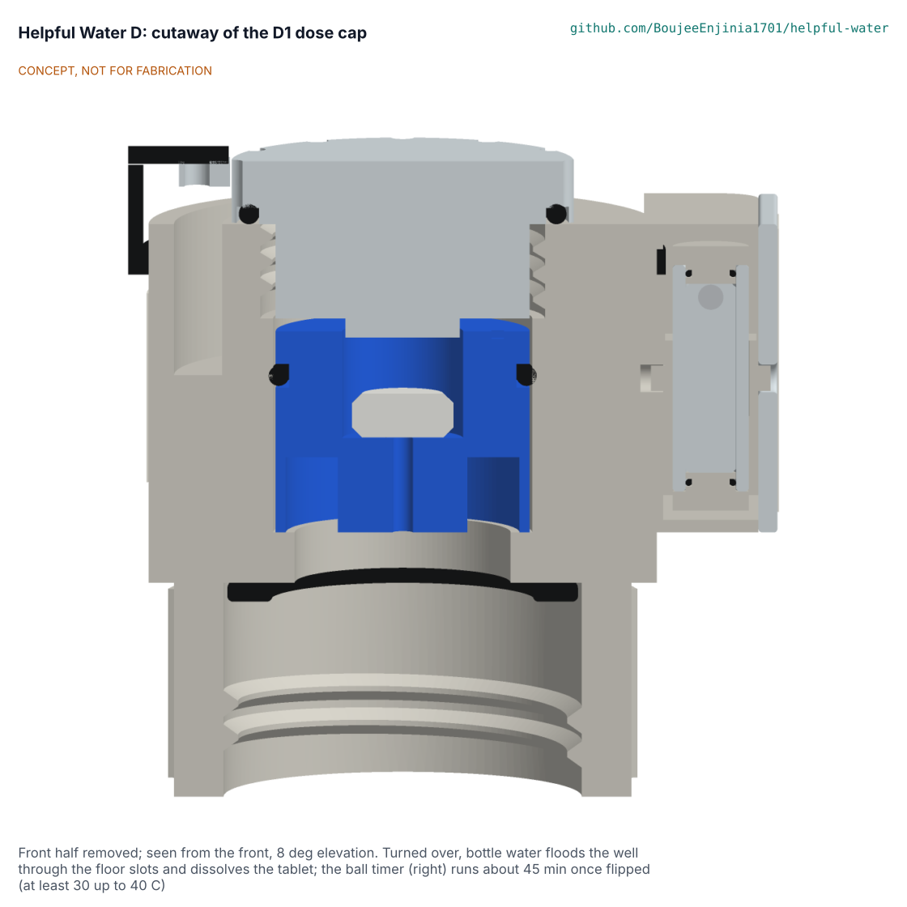

# Helpful Water D: chlorine co-treatment add-on design precis

D1 is a tablet dose cap: a 46 mm cap that screws onto the 28 mm PCO 1881 neck of a PET bottle (the neck the B cartridge fits) or onto the 28 mm port in C's raw-water bucket lid (HWD-DEC-001 D4), holds one NaDCC tablet matched to the container in a colour-keyed well, and carries a flip-over ball timer that shows the 30 minute wait. It is designed to dose chlorine at the household rate used by WHO-referenced programmes, about 2 mg/L, to address viruses and bacteria when used with a filter (HWP-CLM-001). The sequence is the program's: chlorinate the raw water, wait the full contact time, then filter with A, B or C, whose membranes are the barrier for *Cryptosporidium* and whose carbon is intended to take away the chlorine taste. This precis describes option D1, which HWD-OPT-001 recommends; the choice is **decided by Amish on 2026-11-11** (HWD-DEC-001 D1).

> **Release limitation.** Nothing here is a validated water treatment product. No prototype is used to treat water for drinking until its pathogen performance, materials safety, integrity, source suitability and claims are validated by qualified laboratories (HWP-CLM-001).

Figure 1. D1 dose cap cut through its axis: tablet well and plug (centre), ball timer in its side slot (right). CONCEPT, NOT FOR FABRICATION.

## How it works

1. Fill the bottle (or the 20 L bucket for C) with raw water. If it is cloudy, let it settle and pour it off first; if it is muddy (above about 50 NTU), do not rely on D.
2. Unscrew the clear plug, push one tablet out of its foil strip into the well and screw the plug back. The blue 1 L well takes only a 1 L tablet; the orange 20 L well, for C's bucket port, takes the 20 L tablet. Two tablets fit for settled cloudy water; a third does not.
3. Screw the cap on the bottle, turn it over and shake until the tablet has gone (seen through the clear plug). Raw water floods the well through four slots in its floor. Use the blue 1 L tablet only in bottles of 1 to 1.5 L. On C's 20 L bucket, which cannot be turned over, take the plug off, pour raw water through the well from a cup until the tablet has gone, then stir the bucket for 30 seconds with a clean stick (fix F7; the method for the bucket is part of HWD-DEC-001 D4).
4. Stand the bottle up and flip the ball timer so the ball is at the top. It takes about 45 minutes to fall (at least 30 minutes up to 40 C). Above 18 C wait one run, at 10 to 18 C two runs, below 10 C three runs.
5. Take the cap off and filter the water with A, B or C. Drink only filtered water.

## Main components

Cap body with skirt, deck, crown and timer boss; silicone neck liner; keyed well inserts (blue 1 L, orange 20 L) with O-rings; clear well plug with a stop spigot and face O-ring; tether; ball timer (clear tube, two end caps with O-rings, 2 mm stainless ball in sealed silicone fluid, hub with trunnions) behind a clear window held by two screws; scale and pictogram labels. The tablets are standard household NaDCC tablets from humanitarian supply. See `bom/bom.csv` and HWD-DWG-001.

## Key design choices (decided by Amish on 2026-11-11)

- No virus claim for A to C; D is the co-treatment (Amish, 2026-11-11: "No virus claim, co-treat").
- Matched whole tablets, never split tablets: one 3.5 mg NaDCC tablet per 1 L, one 67 mg tablet per 20 L, two for settled turbid water (HWD-DDR-001).
- Keyed inserts and a two-tablet stop so the 5 mg/L guideline value cannot be passed by a wrong or extra tablet (fixes F2, F3, decided under Amish's standing instruction of 2026-10-23, HWD-DDR-003).
- A mechanical ball timer rather than a clock dial, so the wait is shown without a watch; cold water is handled by a run count on the label (F4).
- The cap keeps no tablets loose; spares stay in their foil strips (shelf life 5 years in strips, 3 in tubs).

## First-order numbers (HWD-CAL-001, estimates)

Table 1. First-order numbers for D1.

| Quantity | Value | Basis |
| --- | --- | --- |
| Dose, clear water | 2.0 mg/L (1.6 in 25 L) | IFRC catalogue tablet strengths |
| Dose, settled turbid water | 4.0 mg/L | Two tablets; WHO guideline value 5 mg/L |
| Free chlorine at 30 min, clear | 1.7 mg/L | Assumed demand 0.3 mg/L |
| Free chlorine at 24 h, clear | 0.75 mg/L | Assumed first-order decay |
| CT in 30 min, clear | 53 mg min/L | Against 8 for 4-log virus at 5 C (US EPA) |
| Ball timer | about 34 min at 25 C, at least 30.6 min at -10 % viscosity | Stokes with a wall factor |
| Size and mass | 52 x 41 x 52 mm, about 45 g | Model |
| Prototype parts and test tablets | USD 9.15 against a USD 10 target | BOM |
| Cost per litre at humanitarian tablet prices | about USD 0.0006 (20 L tablets) to USD 0.012 (1 L tablets) | HWD-CAL-001 section 10 |

## Safety

> **Safety:** NaDCC tablets are a chemical: keep strips away from children, never swallow a tablet, and never put tablets in water that is drunk without the full wait. Never use more than two tablets in a container, and never use a 20 L tablet in a bottle (the keyed wells are designed to stop it). Do not mix chlorine products or use pool tablets. Chlorine does not inactivate *Cryptosporidium*: always filter after the wait. In freezing weather empty the cap after use. Prototypes see known potable test water only and nobody drinks from them (HWP-CLM-001 release limitation).

The hazard analysis and design FMEA are in HWD-RSK-001.

## Exclusions

D does not address *Cryptosporidium*, dissolved chemicals, salt, arsenic, nitrate, fluoride, lead, PFAS, pesticides, radiological or unknown industrial contaminants, and it is not for water above about 50 NTU or flood and urban runoff (HWP-SRC-001 SC6). It makes no claim on its own; its claim is for use with a filter, as HWP-CLM-001 states.

## Open questions

See HWD-DEC-001: the concept choice (D1), the independent STEM review (D2), the missing residual after carbon (D3), the interface with C (D4), and the 1 L or 20 L priority (D5).

Licence: this document is licensed under CC-BY-4.0 (Creative Commons Attribution 4.0 International), following the Helpful Engineering licensing guide. Design Molecule Labs with Helpful Engineering.
